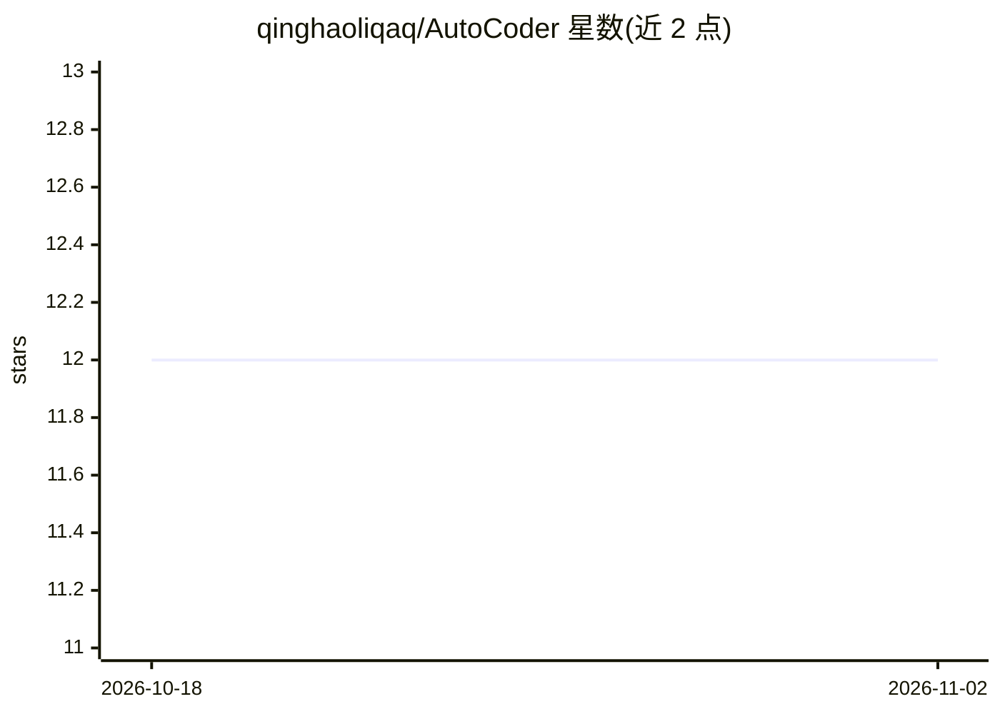

# qinghaoliqaq/AutoCoder

⭐ 12 · Rust · Apache-2.0 · 推送 2026-05-03 · [GitHub](https://github.com/qinghaoliqaq/AutoCoder) · 个人维护

**面向开发者的多 agent 桌面编程工作台：规划到测试全流程编排**

基于 Tauri + React + Rust 的桌面端编码工作区，通过 Director 路由层将软件开发拆分为 plan/code/debug/review/test 五种执行模式，由 Claude 与 Codex CLI 作为本地 Runner 执行。agent 间协调通过共享黑板文件（PLAN_BLACKBOARD.md、BLACKBOARD.md 等）外化为可检查状态。Director 后端可配置 OpenAI 或 Anthropic 兼容 API。项目自述为 alpha 阶段原型，主流程依赖本地 claude/codex CLI 与外部 LLM 端点，命名尚未统一。

## 筛选速览

| 维度 | 判定 | 备注 |
|---|---|---|
| AI 角色 | `ai-ecosystem` | LLM/agent 周边工具 |
| 许可风险 | `permissive` | Apache-2.0 |
| 部署形态 | `library` | 以包/库形式分发 |
| 模型依赖 | locked-api |  |
| 硬件要求 | — | 无带数字的原话,不猜 |
| 安装摩擦 | `low` | 无编译、无系统依赖或容器化 |
| 成熟度 | `idea` | |

## 能力要点

- Director 路由层调度 plan/code/debug/review/test 五种执行模式
- Rust 后端调用本地 claude/codex CLI 执行并流式回传
- 共享黑板文件作为多 agent 协调层，状态外化可检查
- Director 后端支持 OpenAI/Anthropic 兼容 API 配置

## 适用场景

- 在桌面端以多阶段工作流完成从规划到测试的编码任务
- 让 Claude 实现子任务、Codex 审查、再由 Claude 修复
- 查看与恢复带黑板文件和工具调用日志的会话历史

## 场景标签

`编码 Agent` `多智能体` · 领域:Agent 开发

## 证据(README 行号)

> L13: - A `Director` decides which skill should run next
> L74: The Rust backend shells out to local CLIs for execution:
> L87: - `Rust orchestrator`: Director routing, workspace access, session persistence, prompt loading, skill execution, an

## 星数曲线

2026-10-18 12 → 2026-11-02 12（+0）

---
*卡片 v1 · prompt 1.4 · 生成 2026-11-01 · 置信度 high · 依据 README sha `63e11c1e28c9` · [字段定义](../../DATASET.md)*
