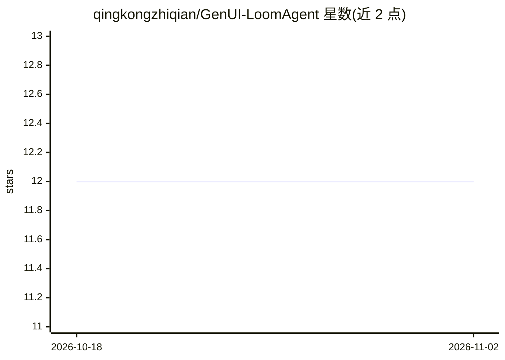

# qingkongzhiqian/GenUI-LoomAgent

⭐ 12 · TypeScript · Apache-2.0 · 推送 2026-03-10 · [GitHub](https://github.com/qingkongzhiqian/GenUI-LoomAgent) · 个人维护 · 中文 README

**生成式 UI Agent 框架：AI 自主决定渲染哪些界面组件**

开源 GenUI Agent 框架，后端基于 Python/FastAPI/LangGraph，前端为 Next.js 15。AI 除生成文本回复外，还输出 { name, props } 形式的组件指令，由前端动态渲染数据列表、图表、天气卡片等 12 类已注册组件。通过 LiteLLM 网关接入任意 LLM 提供商（OpenRouter/OpenAI/Anthropic/Google/DashScope/DeepSeek 等）；通过 YAML 声明式配置接入任意 REST API，无需改后端代码。兼容 AG-UI 协议，可被 CopilotKit 等客户端接入；提供 Docker 一键部署与手动安装两种方式，系统依赖含 Node.js 20+、Python 3.10+、MongoDB。

## 筛选速览

| 维度 | 判定 | 备注 |
|---|---|---|
| AI 角色 | `ai-ecosystem` | LLM/agent 周边工具 |
| 许可风险 | `permissive` | Apache-2.0 |
| 部署形态 | `library` | 以包/库形式分发 |
| 模型依赖 | locked-api |  |
| 硬件要求 | — | 无带数字的原话,不猜 |
| 安装摩擦 | `low` | 无编译、无系统依赖或容器化 |
| 成熟度 | — | 结构信号不足 |

## 能力要点

- AI 自主生成 UI 组件指令（{ name, props }），前端动态渲染 12 类组件
- YAML 声明式接入任意 REST API，5 行配置连接新数据源
- LangGraph 多节点工作流：意图识别、任务分解、并行执行、条件路由（最多 5 轮迭代）
- 通过 LiteLLM 接入任意 LLM 提供商，兼容 AG-UI 协议与 CopilotKit

## 适用场景

- 构建 AI 自主决定界面呈现形式的对话式前端应用
- 不改后端代码，用 YAML 快速把现有 REST API 变成 AI 可调用的服务
- 通过 AG-UI 协议接入 CopilotKit 等第三方前端客户端

## 场景标签

`Agent 框架` · 领域:Agent 开发

## 证据(README 行号)

> L7: An open-source Generative UI Agent framework — the AI doesn't just return text, it autonomously decides which UI com
> L24: LOOM is a **Generative UI (GenUI) Agent** framework. Traditional AI apps return plain text. LOOM's AI backend gener
> L52: |LLM Gateway|LiteLLM — unified interface for **any** LLM provider|

## 星数曲线

2026-10-18 12 → 2026-11-02 12（+0）

---
*卡片 v1 · prompt 1.4 · 生成 2026-11-01 · 置信度 mid · 依据 README sha `16766acfad1a` · [字段定义](../../DATASET.md)*
