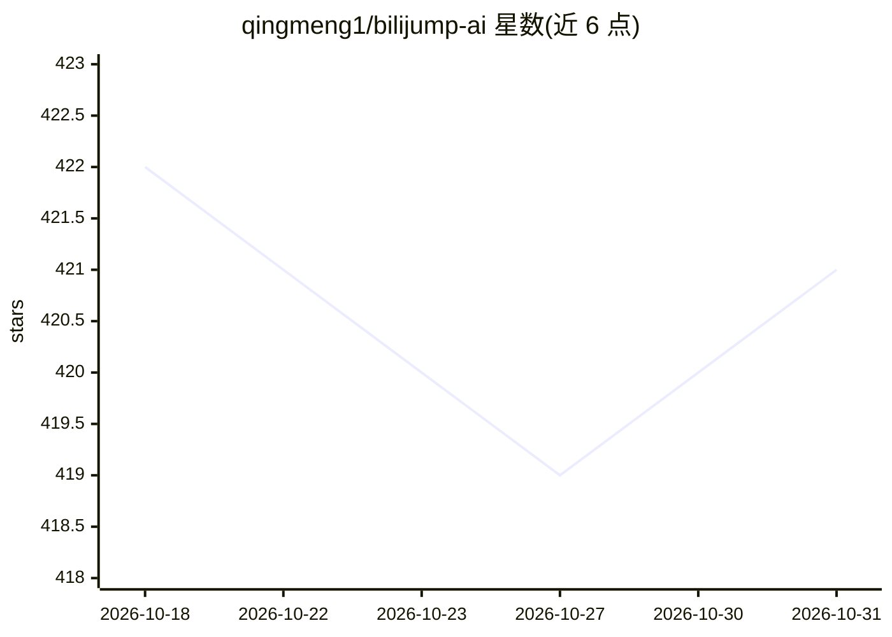

# qingmeng1/bilijump-ai

⭐ 421 · JavaScript · 推送 2026-08-30 · [GitHub](https://github.com/qingmeng1/bilijump-ai) · [官网](https://oooo.uno) · 个人维护 · 中文 README

**用 AI 自动识别并跳过 Bilibili 视频植入广告的浏览器扩展**

Chrome/Firefox 浏览器扩展，通过 AI 分析视频字幕或音频识别植入广告的开始/结束时间，支持自动或弹窗手动跳过。无字幕时可经阿里云 paraformer-v2 转录音频（免费 10 小时/月）。用户可自定义 AI API 密钥、URL 与模型（推荐 Gemini/grok/gpt-4.1），广告数据经 Cloudflare API 云端共享缓存避免重复分析，并提供人工纠错共建数据库。README 提示 AI 可能识别错误、推荐手动跳过；需要 Manifest V3 浏览器与两类 API 密钥。

## 筛选速览

| 维度 | 判定 | 备注 |
|---|---|---|
| AI 角色 | `ai-enhanced` | 去掉 AI 部分产品仍成立 |
| 许可风险 | `none` | — |
| 部署形态 | `None` |  |
| 模型依赖 | — | README 未给出锁定关系 |
| 硬件要求 | — | 无带数字的原话,不猜 |
| 安装摩擦 | `low` | 无编译、无系统依赖或容器化 |
| 成熟度 | — | 结构信号不足 |

## 能力要点

- 字幕优先、音频兜底的 AI 广告识别（阿里云 paraformer-v2 转录，免费 10 小时/月）
- 自动/弹窗手动两种跳过方式，进度条橙色高亮广告区间
- Cloudflare API 云端广告数据共享缓存，避免重复分析
- 人工纠错机制共建广告时间点数据库，支持 UP主/标签过滤

## 适用场景

- 看 B 站视频时自动跳过 UP 主植入的口播广告
- 没字幕的视频用音频转录识别广告片段
- 手动纠错广告区间并共享给其他用户

## 场景标签

`浏览器自动化` · 领域:效率与自动化

## 证据(README 行号)

> L13: 一个使用 AI 自动跳过 Bilibili 视频植入广告的 Chrome 扩展程序。
> L17: **Bilibili AI Skip** 是一个 Chrome 扩展程序，旨在通过 AI 识别并自动跳过 Bilibili 视频中植入的广告。它支持字幕和音频分析，能够精准定位广告的开始和结束时间，并提供手动或自动跳过广告的功能。
> L62: * ​**自动跳过广告**​：通过 AI 分析视频字幕或音频，识别广告并自动跳过。

## 星数曲线

2026-10-18 422 → 2026-10-31 421（-1）

---
*卡片 v1 · prompt 1.4 · 生成 2026-10-21 · 置信度 high · 依据 README sha `afa43feb2238` · [字段定义](../../DATASET.md)*
