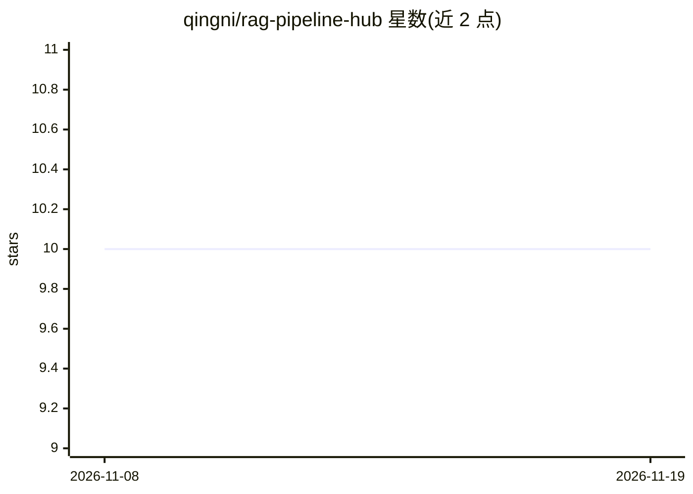

# qingni/rag-pipeline-hub

⭐ 10 · Python · Apache-2.0 · 推送 2026-03-09 · [GitHub](https://github.com/qingni/rag-pipeline-hub) · 个人维护 · 中文 README

**面向真实业务流程的全栈 RAG 平台，覆盖文档到答案生成**

端到端 RAG 框架，覆盖文档接入、分块、向量化、索引管理、混合检索与答案生成，含 FastAPI 后端与 Vue 3 前端。机制上提供 20+ 文档格式解析（Docling Serve 主解析 + 回退 loader）、六种分块策略与基于文档特征分析的策略/参数推荐、嵌入模型分层推荐（语言/领域/多模态）、RRF 排序与 Reranker 重排、SSE 流式生成与来源引用。依赖 Python 3.11、Node.js 18、Milvus（Docker/Colima）及 OpenAI 兼容的 LLM/嵌入服务。

## 筛选速览

| 维度 | 判定 | 备注 |
|---|---|---|
| AI 角色 | `ai-ecosystem` | LLM/agent 周边工具 |
| 许可风险 | `permissive` | Apache-2.0 |
| 部署形态 | `None` |  |
| 模型依赖 | — | README 未给出锁定关系 |
| 硬件要求 | — | 无带数字的原话,不猜 |
| 安装摩擦 | `low` | 无编译、无系统依赖或容器化 |
| 成熟度 | — | 结构信号不足 |

## 能力要点

- 六种分块策略与基于文档特征的智能策略/参数推荐
- bge-m3、qwen3-embedding-8b、qwen3-vl-embedding-8b 等嵌入模型与批量推荐
- 混合检索：稠密/稀疏召回、RRF 排序、Reranker 与查询增强
- 流式生成、来源引用与历史管理

## 适用场景

- 搭建企业内部知识库问答系统
- 对多种格式的文档做分块与向量化处理
- 调试与对比不同分块策略和检索链路的效果

## 场景标签

`RAG` `文档解析` · 领域:知识与检索

## 证据(README 行号)

> L5: An end-to-end RAG framework for real-world workflows, covering document ingestion, chunking, embedding, index manage
> L20: - Hybrid retrieval with dense recall, sparse recall, `RRF` ranking, `Reranker`, and query enhancement
> L31: - OpenAI-compatible LLM and embedding APIs

## 星数曲线

2026-11-08 10 → 2026-11-19 10（+0）

---
*卡片 v1 · prompt 1.4 · 生成 2026-11-19 · 置信度 high · 依据 README sha `b4770b9d0dcd` · [字段定义](../../DATASET.md)*
