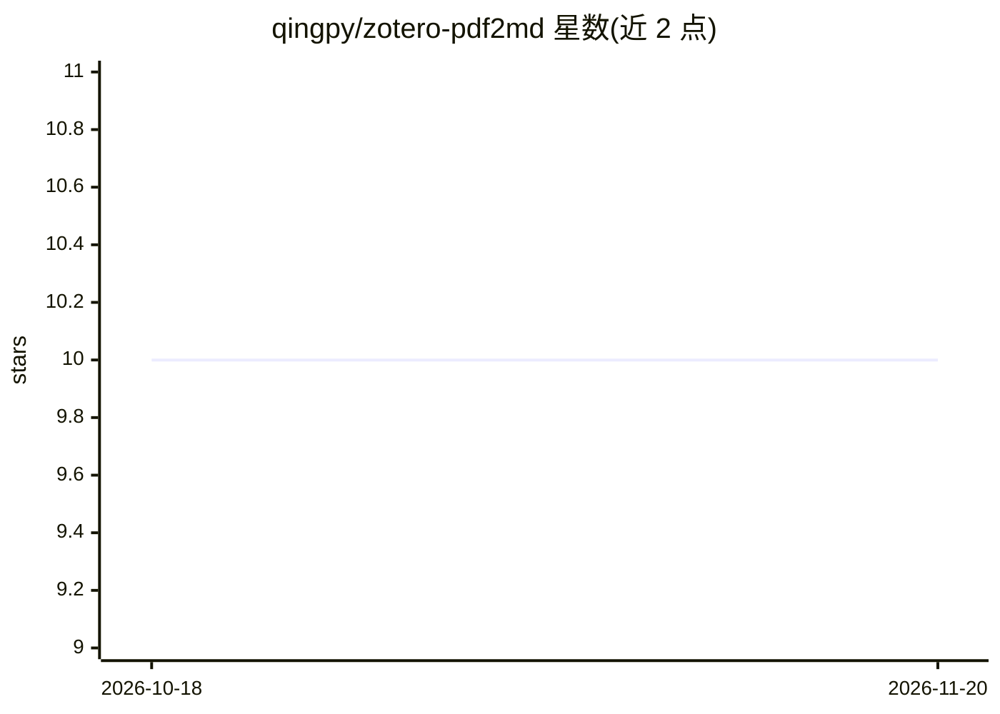

# qingpy/zotero-pdf2md

⭐ 10 · JavaScript · MIT · 推送 2026-11-04 · [GitHub](https://github.com/qingpy/zotero-pdf2md) · 个人维护

**Zotero 插件：将 PDF 附件转为 Markdown 并导出附件**

非官方 Zotero 插件，把文库中的 PDF 附件转换为 Markdown 并将附件导出到指定文件夹。转换由 MinerU 云服务完成，用户需在 mineru.net 获取 API token；无 token 时回退到 MinerU 轻量 API（≤10MB、≤20 页、IP 限流）。可配置模型（VLM/Pipeline）、文档语言、公式表格识别、OCR 及新 PDF 自动转换；支持批量右键转换、去重排队与导出附件。PDF 会上传至 mineru.net，token API 限 200MB/200 页、每日 1000 高优先级页。

## 筛选速览

| 维度 | 判定 | 备注 |
|---|---|---|
| AI 角色 | `ai-native` | 本体是模型或模型工具 |
| 许可风险 | `permissive` | MIT |
| 部署形态 | `None` |  |
| 模型依赖 | — | README 未给出锁定关系 |
| 硬件要求 | — | 无带数字的原话,不猜 |
| 安装摩擦 | `low` | 无编译、无系统依赖或容器化 |
| 成熟度 | — | 结构信号不足 |

## 能力要点

- 右键将 PDF 转为 Markdown 并自动附加 .md 文件，重复请求去重排队
- 支持 VLM/Pipeline 两种模型、OCR 与公式表格识别配置
- 无 token 时回退 MinerU 轻量 API（≤10MB、≤20 页）
- 附件按类型批量导出到默认或指定文件夹

## 适用场景

- 把 Zotero 文献库里的论文批量转成 Markdown 供 LLM/agent 工作流读取
- 减少喂给语言模型的上下文占用（Markdown 比 PDF 更易解析）
- 定期将文献附件整理导出到指定目录

## 场景标签

`文档解析` · 领域:知识与检索

## 证据(README 行号)

> L5: A Zotero plugin that converts PDF attachments to Markdown and exports
> L12: Conversion is performed by MinerU,
> L40: - Settings: model (VLM or Pipeline), document language, formula and table

## 星数曲线

2026-10-18 10 → 2026-11-20 10（+0）

---
*卡片 v1 · prompt 1.4 · 生成 2026-11-19 · 置信度 mid · 依据 README sha `d3e8fb51b1f4` · [字段定义](../../DATASET.md)*
