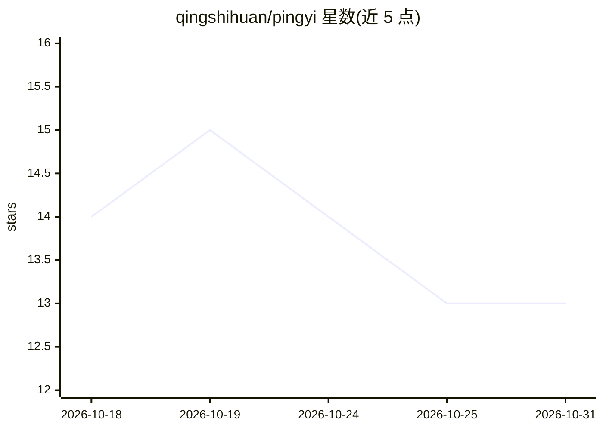

# qingshihuan/pingyi

⭐ 13 · C# · MIT · 推送 2026-09-29 · [GitHub](https://github.com/qingshihuan/pingyi) · 个人维护 · 中文 README

**隐私优先的离线截图 OCR 与翻译桌面工具（Windows/Ubuntu）**

基于 Avalonia/C# 的桌面截图识别工具：框选屏幕后自动在本地探测文字或二维码，再执行文字翻译、图片描述或二维码解析，判断不明时由用户手动切换任务。提供基础模式（本机视觉大模型 OCR+翻译）与轻量模式（PaddleOCR+Argos Translate 全离线），支持 llama.cpp、Ollama、LM Studio、vLLM 等本机服务及 Google Cloud/百度云端凭据。默认 Vulkan 后端，可切换 CUDA/ROCm/CPU；大模型权重不随安装包分发，由引导页按需下载。凭据经 DPAPI/Secret Service 存储，截图与结果不写入日志。

## 筛选速览

| 维度 | 判定 | 备注 |
|---|---|---|
| AI 角色 | `ai-native` | 本体是模型或模型工具 |
| 许可风险 | `permissive` | MIT |
| 部署形态 | `desktop` | 安装包/桌面程序 |
| 模型依赖 | local-ok | 支持本地模型 |
| 硬件要求 | — | 无带数字的原话,不猜 |
| 安装摩擦 | `medium` | 含编译或系统依赖之一 |
| 成熟度 | — | 结构信号不足 |

## 能力要点

- 基础模式为本机视觉大模型直接 OCR 与翻译，轻量模式为 PaddleOCR+Argos Translate 全离线兜底
- 安装包内置 OCR/翻译模型与 llama.cpp CPU/Vulkan 运行时，无需另装 Python 或 .NET
- 兼容 llama.cpp、Ollama、LM Studio、vLLM 等 Chat Completions 服务，可选 Google Cloud/百度云
- 本地二维码解码、数据不写日志、凭据用系统密钥存储

## 适用场景

- 截图后自动翻译外文界面文字，默认本机处理
- 离线环境下对截图做 OCR 与中英翻译
- 解析屏幕上的二维码而不自动打开网址
- 用本机视觉模型对截图生成图片描述或反推提示词

## 场景标签

`OCR` · 领域:感知与多模态

## 证据(README 行号)

> L14: 截屏释义（原 PingYi／屏译）是一款桌面截图识别工具。点击“一键识别”并框选屏幕，软件先在本地检查文字与二维码，再选择文字翻译、图片描述或二维码解析。判断不明确时由你选择；结果窗口始终保留手动任务切换，使用同一张截图，无需重新
> L85: **直接视觉 OCR 和翻译。**支持 llama.cpp、Ollama、LM Studio、vLLM 等兼容 Chat Completions 服务。基础模式仅接受本机回环端点；远程端点归入自定义组合。识别质量与语言范围取决于所

## 星数曲线

2026-10-18 14 → 2026-10-31 13（-1）

---
*卡片 v1 · prompt 1.4 · 生成 2026-10-31 · 置信度 high · 依据 README sha `cb9473ff9ee4` · [字段定义](../../DATASET.md)*
