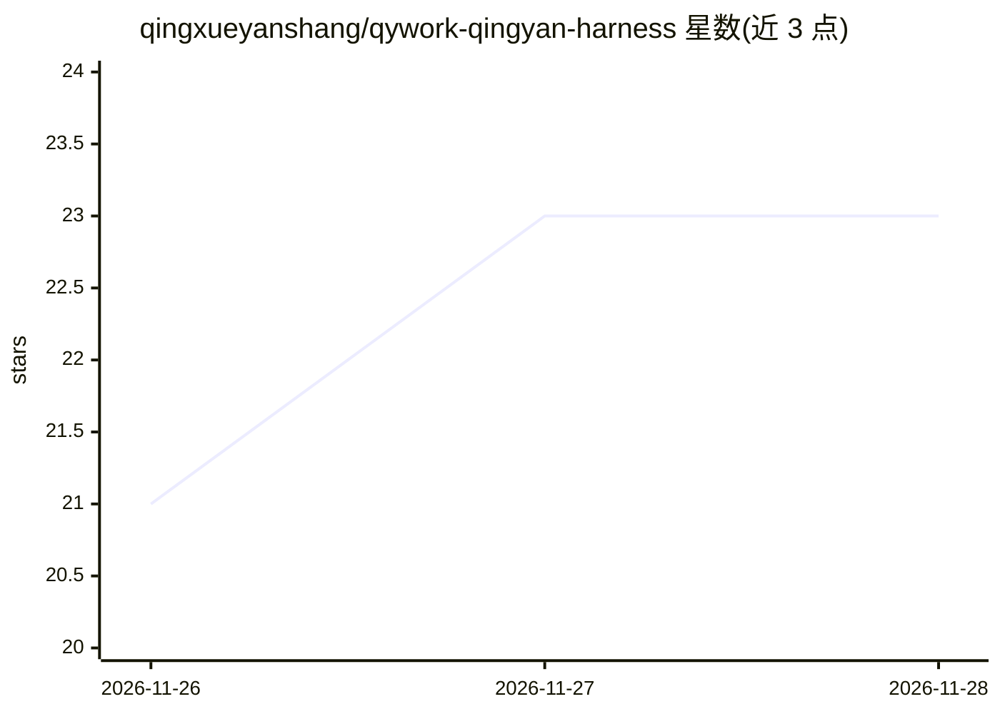

# qingxueyanshang/qywork-qingyan-harness

⭐ 23 · TypeScript · Apache-2.0 · 推送 2026-11-27 · [GitHub](https://github.com/qingxueyanshang/qywork-qingyan-harness) · [官网](https://qywork.io) · 个人维护 · 中文 README

**给开发者的多模型多 Agent 协作桌面工作台（Agent Harness）**

将模型推理与工具执行、上下文管理、记忆、技能、任务编排组合到本地工作台的 Agent Harness，基于 Bun 编译内核与 Tauri 2 桌面外壳。支持多模型多服务接入与会话内切换、主/子 Agent 组成 DAG 任务图跨模型分工、提示词缓存复用、MCP 工具接入与插件扩展；工作台提供画布生成图像视频、Office 文档制作、浏览器与终端面板、用量与缓存统计。桌面版约 41 MiB 安装包，安装即可运行；配置与数据保存在本机，可选登录账号使用云端模型与远程访问。

## 筛选速览

| 维度 | 判定 | 备注 |
|---|---|---|
| AI 角色 | `ai-ecosystem` | LLM/agent 周边工具 |
| 许可风险 | `permissive` | Apache-2.0 |
| 部署形态 | `desktop` | 安装包/桌面程序 |
| 模型依赖 | — | README 未给出锁定关系 |
| 硬件要求 | — | 无带数字的原话,不猜 |
| 安装摩擦 | `low` | 无编译、无系统依赖或容器化 |
| 成熟度 | — | 结构信号不足 |

## 能力要点

- 多模型接入：Anthropic Messages / OpenAI Chat Completions / OpenAI Responses 三类协议，含本地模型服务
- 多 Agent DAG 协作：独立上下文、跨模型分工、异步执行与检查点审查
- 模块化 Harness：Skills / Memory / MCP / Plugins / Agent Team 设置入口
- 画布编排图像、视频与音频生成卡；读取制作 Word、PPT、Excel

## 适用场景

- 在同一工作台中用多个模型并行分析代码并分工实施修改
- 在画布中批量生成角色图、场景图与分镜视频并导出成片
- 接入行业技能、项目记忆与业务系统 MCP 运行领域任务
- 本地保存配置与会话，按 token 用量与缓存费用做用量审查

## 场景标签

`多智能体` `提示工程` `Agent 框架` · 领域:Agent 开发

## 证据(README 行号)

> L3: **多模型接入、多 Agent 协作的轻量化开源 Agent Harness。**
> L5: Agent = Model + Harness。模型负责推理，qywork 提供工具执行、上下文管理、记忆、技能与任务编排，
> L30: - 对话模型支持 **Anthropic Messages、OpenAI Chat Completions、OpenAI Responses** 三类接口，可接入官方服务与兼容这些协议的服务，包括本地模型服务。

## 星数曲线

2026-11-26 21 → 2026-11-28 23（+2）

---
*卡片 v1 · prompt 1.4 · 生成 2026-11-26 · 置信度 high · 依据 README sha `4ac4ca298d02` · [字段定义](../../DATASET.md)*
