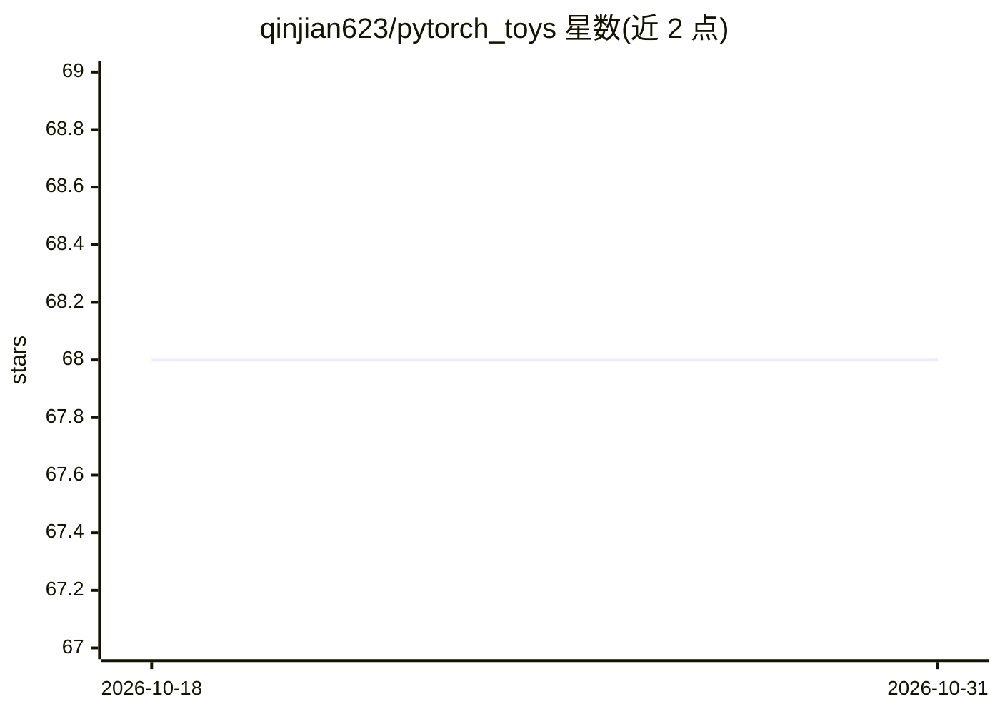

# qinjian623/pytorch_toys

⭐ 68 · Python · MIT · 推送 2026-10-09 · [GitHub](https://github.com/qinjian623/pytorch_toys) · 个人维护

**个人 PyTorch 实验脚本集：聚类、量化、蒸馏等小实验**

一组小型 PyTorch 实验脚本集合，覆盖批式 k-means 与乘积量化、假量化流水线（resnet101 校准评估）、官方后训练量化参考（resnet18）、CIFAR-10 随机噪声正则化训练、蒸馏损失 DistillLoss 与 Conv2d 交叉注意力模块。面向想直接运行和修改实验代码的开发者；数据集需自行准备 ImageNet 验证集并修改脚本内硬编码路径，CIFAR-10 自动下载，CUDA 可选、脚本均回退 CPU 执行。以源码形式提供，无打包发布。

## 筛选速览

| 维度 | 判定 | 备注 |
|---|---|---|
| AI 角色 | `ai-native` | 本体是模型或模型工具 |
| 许可风险 | `permissive` | MIT |
| 部署形态 | `library` | 以包/库形式分发 |
| 模型依赖 | — | README 未给出锁定关系 |
| 硬件要求 | — | 无带数字的原话,不猜 |
| 安装摩擦 | `medium` | 含编译或系统依赖之一 |
| 成熟度 | — | 结构信号不足 |

## 能力要点

- 批式 k-means 与乘积量化（PQ 距离表、非对称检索）实现
- resnet101 假量化校准流水线与 resnet18 官方 PTQ 参考脚本
- KL+CE 混合蒸馏损失 DistillLoss（支持稀疏 top-k 蒸馏）
- 训练时前向扰动参数的 Noiser 正则化与 Conv2d 交叉注意力模块

## 适用场景

- 学习或复现量化校准与 PTQ 流程
- 做聚类/乘积量化的速度与召回基准测试
- 在 CIFAR-10 上实验噪声正则化训练

## 场景标签

`模型量化` · 领域:训练与推理

## 证据(README 行号)

> L2: A grab bag of small PyTorch experiments covering clustering, quantization, noiser-based regularization, attention bl
> L42: - *What it does*: ``cluster/kmeans.py`` implements batched k-means along with product quantization helpers (PQ dist

## 星数曲线

2026-10-18 68 → 2026-10-31 68（+0）

---
*卡片 v1 · prompt 1.4 · 生成 2026-10-24 · 置信度 mid · 依据 README sha `29d6698e0df1` · [字段定义](../../DATASET.md)*
