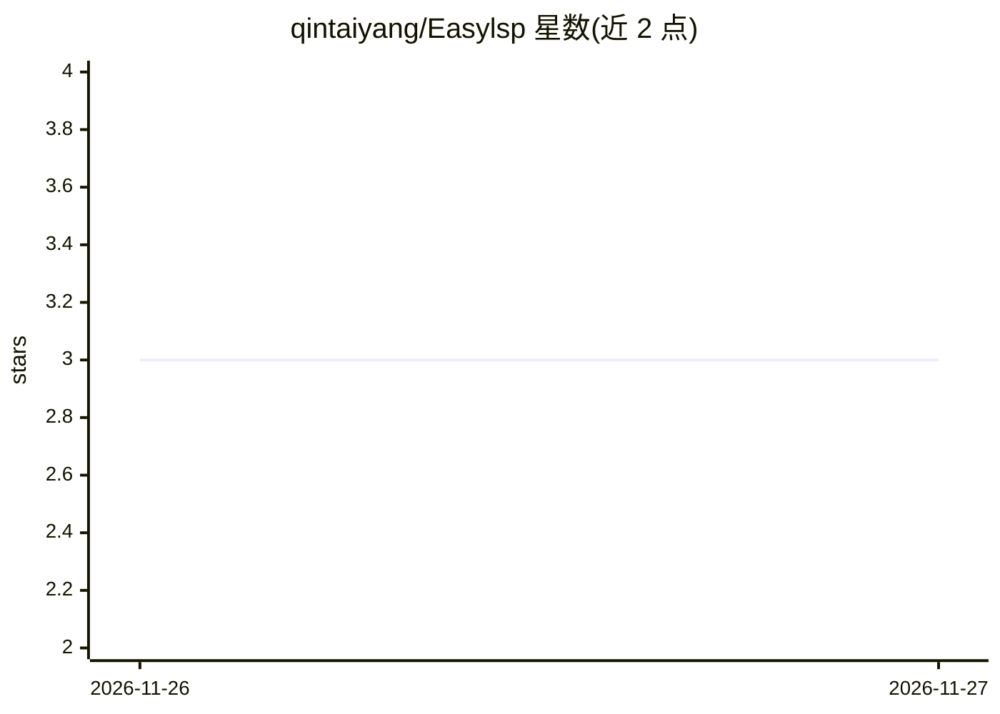

# qintaiyang/Easylsp

⭐ 3 · Kotlin · GPL-3.0 · 推送 2026-11-08 · [GitHub](https://github.com/qintaiyang/Easylsp) · 个人维护 · 中文 README

**AI 驱动的 Android 模块开发与调试工具**

面向 Android 的模块开发与调试工具，基于 Xposed/LSPosed 生态：用户可用自然语言让 AI 分析目标应用、编写 Java/Native 插件、构建并查看结果，也可用内置编辑器和调试工具手动开发。功能覆盖应用分析、插件市场、PTY 终端、Ubuntu chroot、MCP 与后台保活。需要 root 及 libxposed 框架，AI 功能需自行配置模型供应商与 API Key，支持 OpenAI 兼容、Anthropic 和 Gemini 协议。

## 筛选速览

| 维度 | 判定 | 备注 |
|---|---|---|
| AI 角色 | `ai-enhanced` | 去掉 AI 部分产品仍成立 |
| 许可风险 | `viral` | GPL-3.0 |
| 部署形态 | `None` |  |
| 模型依赖 | — | README 未给出锁定关系 |
| 硬件要求 | — | 无带数字的原话,不猜 |
| 安装摩擦 | `high` | 编译与系统依赖俱全 |
| 成熟度 | `idea` | |

## 能力要点

- 自然语言驱动应用分析与插件编写，Java/Native 插件均可由 AI 生成并构建运行
- Java 插件支持 BeanShell Hook 与插件市场发行，Native 插件支持 Zygisk/libxposed 双后端
- 应用分析可查询类、方法、字段并检视目标进程与 View 树
- AI 助手支持项目会话、附件、历史分支、任务用量与工具授权

## 适用场景

- 开发 Xposed/LSPosed Hook 模块时让 AI 代写并调试插件
- 在手机上直接分析目标应用的类、方法与资源
- 为自研模块搭建从编写到市场发行的完整流程

## 场景标签

`编码 Agent` `代码生成` · 领域:编码与开发

## 证据(README 行号)

> L5: Easylsp 是面向 Android 的开源模块开发与调试工具。用自然语言描述目标，让 AI 分析应用、编写 Java／Native 插件、构建运行并查看结果，也可以使用编辑器和调试工具手动开发。
> L12: - **AI 助手**：支持 OpenAI 兼容、Anthropic 和 Gemini 协议，提供项目会话、附件、历史分支、任务用量和工具授权。
> L24: - Hook 工作流需要 root 及支持现代 libxposed API 101+ 的框架；在框架中启用 Easylsp 并批准目标作用域。

## 星数曲线

2026-11-26 3 → 2026-11-27 3（+0）

---
*卡片 v1 · prompt 1.4 · 生成 2026-11-26 · 置信度 high · 依据 README sha `efa1a005030b` · [字段定义](../../DATASET.md)*
