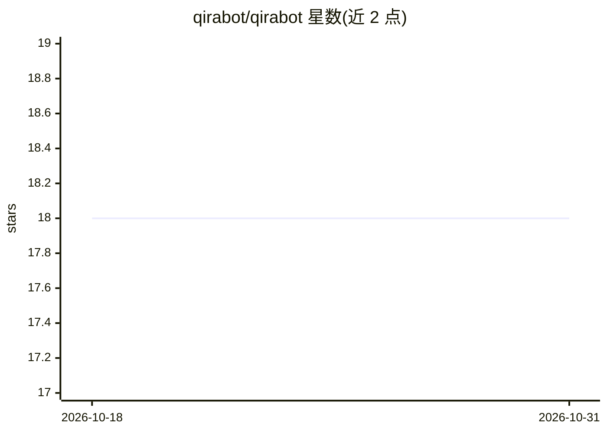

# qirabot/qirabot

⭐ 18 · Python · MIT · 推送 2026-10-29 · [GitHub](https://github.com/qirabot/qirabot) · [官网](https://qirabot.com) · 组织维护 · 中文 README

**用多模态 AI 视觉驱动的跨平台 GUI 自动化工具**

面向浏览器、Android/iOS、Windows 桌面与游戏的像素级 GUI 自动化工具：截图直接送至用户配置的视觉模型（Google Vertex AI 或 Gemini Developer API），由模型决定下一步操作并循环至任务完成，不依赖 DOM 与选择器。可独立运行，也可挂接到既有 Playwright/Selenium/Appium/pytest 会话，支持自然语言定位元素、挂载领域知识文件、注册 Python 自定义工具供模型调用。提供 CLI、Python SDK、Agent Skills 技能包与每步截图的 HTML 报告，MIT 许可。

## 筛选速览

| 维度 | 判定 | 备注 |
|---|---|---|
| AI 角色 | `ai-native` | 本体是模型或模型工具 |
| 许可风险 | `permissive` | MIT |
| 部署形态 | `library` | 以包/库形式分发 |
| 模型依赖 | — | README 未给出锁定关系 |
| 硬件要求 | — | 无带数字的原话,不猜 |
| 安装摩擦 | `low` | 无编译、无系统依赖或容器化 |
| 成熟度 | — | 结构信号不足 |

## 能力要点

- 像素级驱动浏览器/移动端/桌面/游戏，无需 DOM 或选择器
- 可挂接既有 Playwright/Selenium/Appium/pytest 会话混合使用
- custom_tools 注册 Python 函数供模型中途调用（内部 API、OTP、人工接管等）
- Agent Skills 开放标准技能包，可被 Claude Code/Codex/Cursor 加载

## 适用场景

- 用一句自然语言让 AI 完成网页或 App 操作任务
- 在既有自动化测试中补充选择器难以覆盖的视觉步骤
- 驱动无 DOM 的游戏完成新手流程或日常任务

## 场景标签

`GUI 自动化` `浏览器自动化` · 领域:效率与自动化

## 证据(README 行号)

> L5: Cross-platform GUI automation, driven by multimodal AI vision. Drive browsers, mobile apps, full desktops, and games
> L9: The decision engine runs in your own process: each screenshot goes directly from your machine to a vision model you 
> L125: The CLI is powered by the same engine. Call `bot.ai()` from Python and the AI

## 星数曲线

2026-10-18 18 → 2026-10-31 18（+0）

---
*卡片 v1 · prompt 1.4 · 生成 2026-10-29 · 置信度 mid · 依据 README sha `626fcd542764` · [字段定义](../../DATASET.md)*
