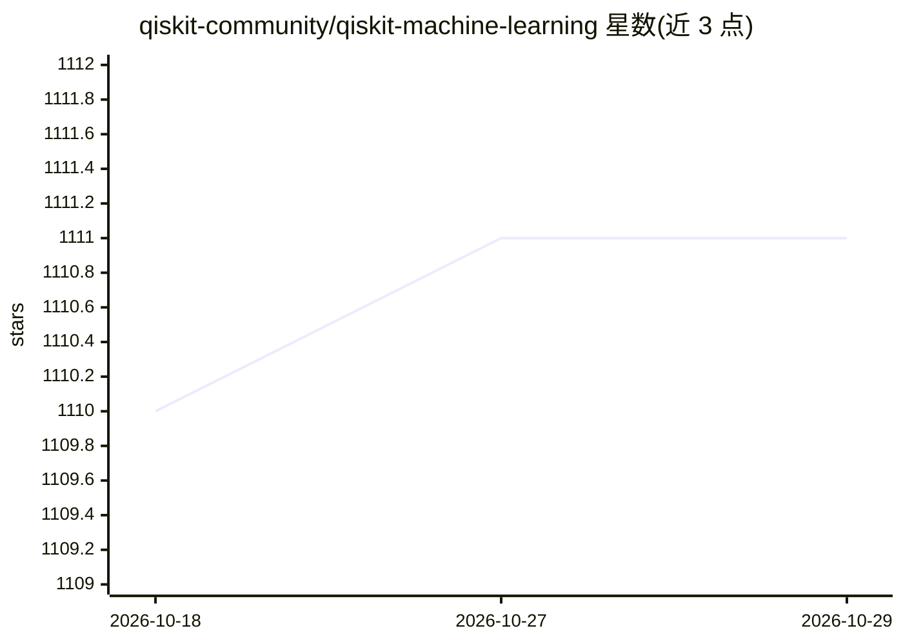

# qiskit-community/qiskit-machine-learning

⭐ 1,111 · Python · Apache-2.0 · 推送 2026-08-19 · [GitHub](https://github.com/qiskit-community/qiskit-machine-learning) · [官网](https://qiskit-community.github.io/qiskit-machine-learning/) · 组织维护

**基于 Qiskit 的量子机器学习库：量子核与量子神经网络**

Qiskit 社区生态下的量子机器学习 Python 库，由 IBM 与英国 Hartree Centre（STFC）共同维护。提供量子核（FidelityQuantumKernel，可配 QSVC/QSVR）、量子神经网络（EstimatorQNN/SamplerQNN）及 VQC/VQR 等学习算法，支持在量子硬件与经典模拟器上运行分类与回归任务。通过 TorchConnector 与 PyTorch 集成实现混合量子-经典网络的自动微分。以 pip 安装，PyTorch/Sparse/NLopt 为可选依赖，附 arXiv 论文与教程 notebooks。

## 筛选速览

| 维度 | 判定 | 备注 |
|---|---|---|
| AI 角色 | `ai-native` | 本体是模型或模型工具 |
| 许可风险 | `permissive` | Apache-2.0 |
| 部署形态 | `library` | 以包/库形式分发 |
| 模型依赖 | — | README 未给出锁定关系 |
| 硬件要求 | — | 无带数字的原话,不猜 |
| 安装摩擦 | `low` | 无编译、无系统依赖或容器化 |
| 成熟度 | — | 结构信号不足 |

## 能力要点

- 量子核方法可结合 QSVC/QSVR 解决分类与回归，兼容经典核算法
- EstimatorQNN/SamplerQNN 通用神经网络接口与 VQC/VQR 高层算法
- TorchConnector 集成 PyTorch，反向传播覆盖量子网络梯度
- 可在量子硬件与经典模拟器上运行

## 适用场景

- 快速原型化量子机器学习分类/回归模型
- 构建混合量子-经典神经网络研究
- 学习量子机器学习基础算法与理论（教程与 Textbook notebooks）

## 场景标签

 · 领域:量子机器学习

## 证据(README 行号)

> L16: Qiskit Machine Learning introduces fundamental computational building blocks, such as Quantum
> L17: Kernels and Quantum Neural Networks, used in various applications including classification

## 星数曲线

2026-10-18 1,110 → 2026-10-29 1,111（+1）

---
*卡片 v1 · prompt 1.4 · 生成 2026-10-21 · 置信度 high · 依据 README sha `e17c097bc35f` · [字段定义](../../DATASET.md)*
