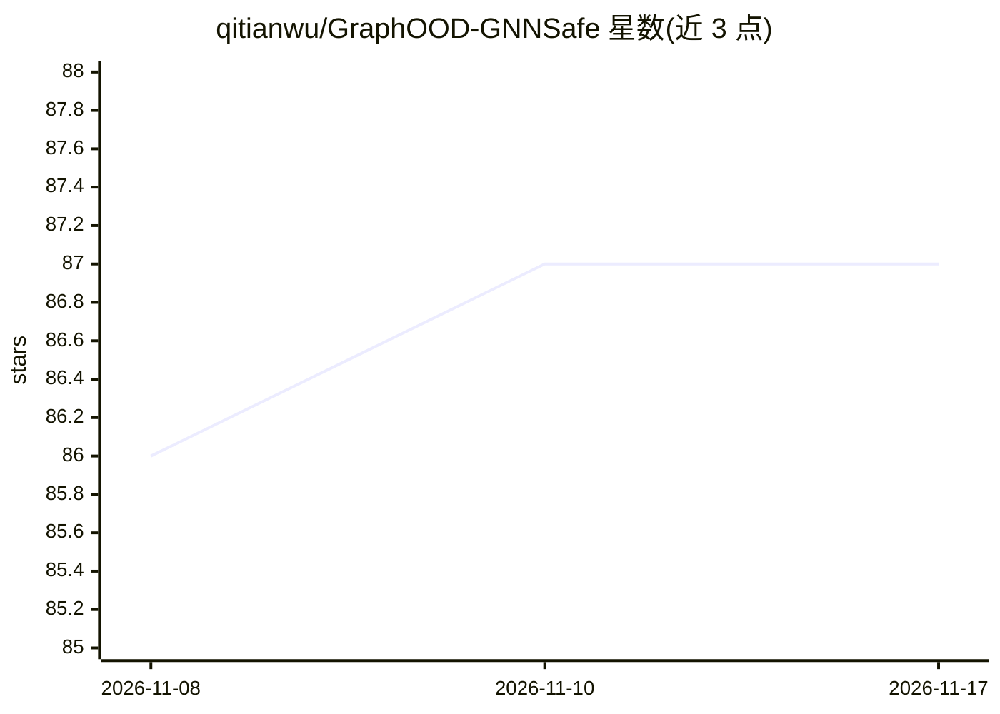

# qitianwu/GraphOOD-GNNSafe

⭐ 87 · Python · 推送 2026-11-06 · [GitHub](https://github.com/qitianwu/GraphOOD-GNNSafe) · 组织维护

**ICLR2023 论文官方实现：图神经网络能量法 OOD 检测**

ICLR2023 论文 GNNSafe 的官方代码实现：基于能量的图数据分布外（OOD）节点检测，通过能量信念传播与正则化损失（GNNSafe/GNNSafe++）区分分布内与 OOD 节点，同时保持分类性能。提供 Twitch、Arxiv、Cora、Amazon、Coauthor 五个数据集的划分协议与三种 OOD 构造方式，复现脚本覆盖主结果、超参搜索与可视化，并支持监督节点分类。依赖 PyTorch 1.9.0 与 PyTorch Geometric 2.0.3，需 CUDA 环境，面向科研复现与后续研究。

## 筛选速览

| 维度 | 判定 | 备注 |
|---|---|---|
| AI 角色 | `ai-native` | 本体是模型或模型工具 |
| 许可风险 | `none` | — |
| 部署形态 | `None` |  |
| 模型依赖 | — | README 未给出锁定关系 |
| 硬件要求 | — | 无带数字的原话,不猜 |
| 安装摩擦 | `medium` | 含编译或系统依赖之一 |
| 成熟度 | `idea` | |

## 能力要点

- 基于能量的 OOD 检测器，含能量信念传播与 OOD 暴露正则化两个版本
- 包含 Energy/OE/ODIN/Mahalanobis/GKDE/GPN 等基线实现
- 五个图数据集的新 OOD 检测基准与三种 OOD 数据构造方式
- 支持监督节点分类模式与超参搜索、能量可视化脚本

## 适用场景

- 复现 ICLR2023 论文的实验结果
- 在图数据上做 OOD 节点检测方法研究与对比
- 复用数据划分协议构造图 OOD 检测基准

## 场景标签

`科研工具` · 领域:学习与行业

## 证据(README 行号)

> L3: The official implementation for ICLR2023 paper "Energy-based Out-of-Distribution Detection for Graph Neural Networks
> L82:  - `gnnsafe` (***GNNSafe*** in paper): the energy-based OOD detector with energy belief propagation
> L84:  - `gnnsafe++` (***GNNSafe++*** in paper): the energy-based OOD detector with energy propagation and regularization

## 星数曲线

2026-11-08 86 → 2026-11-17 87（+1）

---
*卡片 v1 · prompt 1.4 · 生成 2026-11-17 · 置信度 high · 依据 README sha `434f21958a8f` · [字段定义](../../DATASET.md)*
