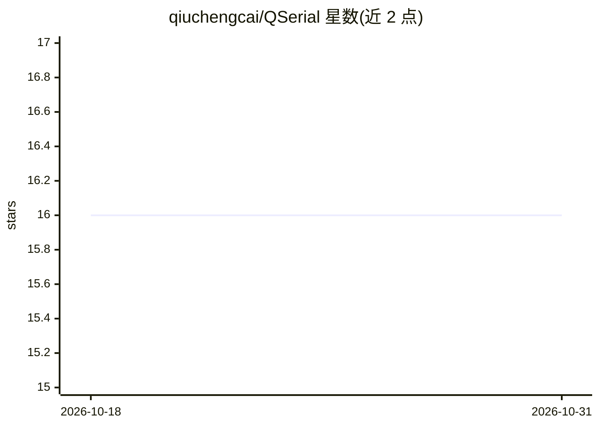

# qiuchengcai/QSerial

⭐ 16 · TypeScript · MIT · 推送 2026-09-11 · [GitHub](https://github.com/qiuchengcai/QSerial) · [官网](https://qserial.echomcp.cn) · 个人维护 · 中文 README

**带内置 MCP 服务器的跨平台串口/SSH/Telnet 终端工具，供 AI agent 操控设备**

基于 Electron + React + TypeScript 的桌面终端工具，支持串口、SSH、Telnet、PTY 连接管理，数据收发与模式匹配，多步脚本与自动登录，21 种设备类型探测，SFTP/XMODEM/YMODEM 文件传输，以及模式告警与会话录制。内置 MCP 服务器（Streamable HTTP 与 SSE 两种传输），让 Claude/Copilot/Cursor 等 AI agent 通过 conn.* 等工具直接操控连接的设备；默认仅监听 127.0.0.1，非 localhost 监听时自动生成鉴权令牌。面向需要 AI 辅助操作嵌入式设备与远程主机的开发者和硬件调试场景。需 Node >= 20、pnpm、python3 从源码构建，无现成安装包直接下载。

## 筛选速览

| 维度 | 判定 | 备注 |
|---|---|---|
| AI 角色 | `ai-ecosystem` | LLM/agent 周边工具 |
| 许可风险 | `permissive` | MIT |
| 部署形态 | `desktop` | 安装包/桌面程序 |
| 模型依赖 | — | README 未给出锁定关系 |
| 硬件要求 | — | 无带数字的原话,不猜 |
| 安装摩擦 | `low` | 无编译、无系统依赖或容器化 |
| 成熟度 | — | 结构信号不足 |

## 能力要点

- 内置 MCP 服务器，AI agent 可直接操控串口/SSH/Telnet/PTY 连接
- 支持 Streamable HTTP 与 SSE 两种 MCP 传输，非 localhost 监听时自动生成鉴权令牌
- 设备检测覆盖 21 种类型，含状态分析与探测报告工具
- 多步脚本、自动登录、SFTP/XMODEM/YMODEM 文件传输与会话录制

## 适用场景

- 让 Claude/Copilot/Cursor 等 AI 客户端直接发送命令并读取设备输出
- 嵌入式设备调试时做模式匹配告警与自动状态分析
- 通过串口或 SSH 对设备执行多步自动化脚本与文件传输

## 场景标签

 · 领域:开发工具/嵌入式设备管理

## 证据(README 行号)

> L3: AI-powered serial console and device management tool. Built on Electron + MCP (Model Context Protocol).
> L9:     participant AI as AI Agent (Claude/Copilot/Cursor...)
> L10:     participant MCP as QSerial MCP Server

## 星数曲线

2026-10-18 16 → 2026-10-31 16（+0）

---
*卡片 v1 · prompt 1.4 · 生成 2026-10-30 · 置信度 low · 依据 README sha `a3789df40861` · [字段定义](../../DATASET.md)*
