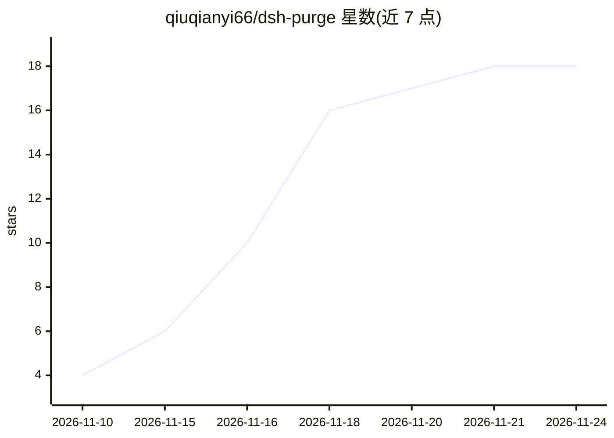

# qiuqianyi66/dsh-purge

⭐ 18 · JavaScript · Apache-2.0 · 推送 2026-11-22 · [GitHub](https://github.com/qiuqianyi66/dsh-purge) · [官网](https://github.com/qiuqianyi66/dsh-purge#readme) · 个人维护 · 中文 README

**DeepSeek Harness 的本机红队评测插件：82 条宿主补丁，可一键还原**

面向本机已授权环境的安全评测工具：向 DeepSeek Harness（DSH 0.2.2-rc.3）注入 82 条分组宿主补丁与按模型替换的提示词，将宿主层策略拦截与模型层拒答分开观测。每处修改先备份、支持一键还原；提供漂移诊断、升级前离体审计（隔离树试打）与四级证据矩阵。仅允许本机回环与 RFC1918 目标，代码层强制安全边界。以 DSH 插件形式安装，需 Node.js ≥ 18 与 pnpm。

## 筛选速览

| 维度 | 判定 | 备注 |
|---|---|---|
| AI 角色 | `ai-ecosystem` | LLM/agent 周边工具 |
| 许可风险 | `permissive` | Apache-2.0 |
| 部署形态 | `library` | 以包/库形式分发 |
| 模型依赖 | locked-api |  |
| 硬件要求 | — | 无带数字的原话,不猜 |
| 安装摩擦 | `low` | 无编译、无系统依赖或容器化 |
| 成熟度 | — | 结构信号不足 |

## 能力要点

- 82 条补丁分布于 65 个载体键，覆盖 Web 与桌面两个 surface
- 每文件应用前备份 .dshpurge.bak，可一键还原与卸载
- --diagnose 漂移诊断与升级前离体审计（audit-next 隔离树试打）
- 目标范围代码层限制在本机回环与 RFC1918 私网

## 适用场景

- 本机授权环境下评测 DSH 宿主层拦截与模型层拒答的差异
- 宿主升级前预检补丁是否静默失效
- 对补丁覆盖状态做漂移诊断与证据审计

## 场景标签

`模型评测` `网络安全` · 领域:评测与运维

## 证据(README 行号)

> L27: > dsh-purge 是 **DeepSeek Harness（DSH）的本机红队评测插件**：用 82 条分组宿主补丁和按模型替换的提示词，把「宿主层策略拦截」和「模型层拒答」分开观测；每个被改文件先备份、可一键还原；升级宿主
> L94: **是什么：** 装在你本机 DeepSeek Harness 里的插件。它把「宿主层策略拦截」和「模型层回答」拆开观测：宿主改了系统提示词、审批门、沙箱策略、会话格式，同一句问题在两处被拦下的表现几乎一样，这个插件让它们可分辨、
> L161: --diagnose [--json]       # 只读：逐条补丁的漂移诊断

## 星数曲线

2026-11-10 4 → 2026-11-24 18（+14）

---
*卡片 v1 · prompt 1.4 · 生成 2026-11-18 · 置信度 mid · 依据 README sha `df7f1a999dc9` · [字段定义](../../DATASET.md)*
