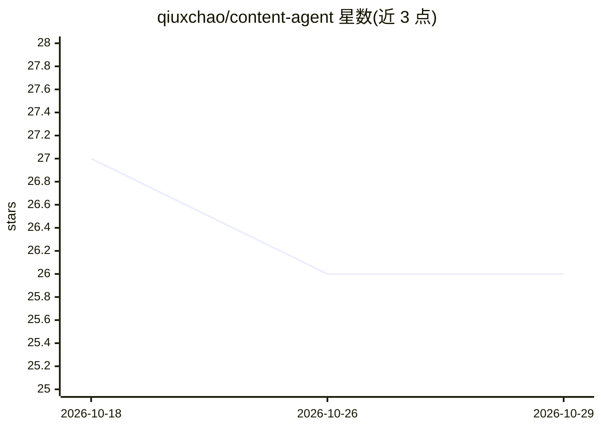

# qiuxchao/content-agent

⭐ 26 · Python · MIT · 推送 2026-03-31 · [GitHub](https://github.com/qiuxchao/content-agent) · 个人维护 · 中文 README

**输入主题自动生成公众号/小红书/知乎文章并配图的 AI 内容 Agent**

基于 LangGraph + LangChain 构建的内容生产应用：用户输入主题，经 Tavily 搜索最新资讯、LLM 提炼素材后，按公众号/小红书/知乎三平台风格生成长文、笔记或问答，并由 Critic 节点打分（10 分制）不达标自动重写。配图支持多种 AI 生图 Provider、Unsplash 搜图、Playwright 网页截图及免费提示词占位模式；历史素材存入本地 Chroma 向量库形成 RAG 复用。支持一键发布到微信公众号草稿箱。需自备 LLM API Key 与 Tavily API Key，以 Web UI 或命令行方式运行。

## 筛选速览

| 维度 | 判定 | 备注 |
|---|---|---|
| AI 角色 | `ai-native` | 本体是模型或模型工具 |
| 许可风险 | `permissive` | MIT |
| 部署形态 | `None` |  |
| 模型依赖 | — | README 未给出锁定关系 |
| 硬件要求 | — | 无带数字的原话,不猜 |
| 安装摩擦 | `low` | 无编译、无系统依赖或容器化 |
| 成熟度 | — | 结构信号不足 |

## 能力要点

- 按公众号/小红书/知乎三平台风格自动适配生成文章
- Tavily 搜索素材 + Critic 质量打分不达标自动重写
- 多 Provider AI 配图 + Unsplash 搜图 + Playwright 网页截图混合模式
- 本地 Chroma 向量库 RAG 复用历史素材，一键发布微信公众号草稿箱

## 适用场景

- 自媒体运营者按主题批量产出多平台文章初稿
- 技术资讯类文章配官网截图或 AI 生成插图
- 团队将生成的长文直接推送至公众号草稿箱排版发布

## 场景标签

`AI 写作` `图像生成` · 领域:内容生成

## 证据(README 行号)

> L3: 基于 LangGraph + LangChain 构建的 AI 内容生产 Agent。输入主题，自动搜集资讯、生成多平台文章并配图，支持一键发布到微信公众号草稿箱。
> L10: - 多平台写作：公众号（深度长文）、小红书（种草笔记）、知乎（专业问答），自动适配各平台风格
> L13: - 质量自检：Critic 节点给初稿打分（满分 10 分），不达标自动重写

## 星数曲线

2026-10-18 27 → 2026-10-29 26（-1）

---
*卡片 v1 · prompt 1.4 · 生成 2026-10-26 · 置信度 high · 依据 README sha `e73e8d79ce32` · [字段定义](../../DATASET.md)*
