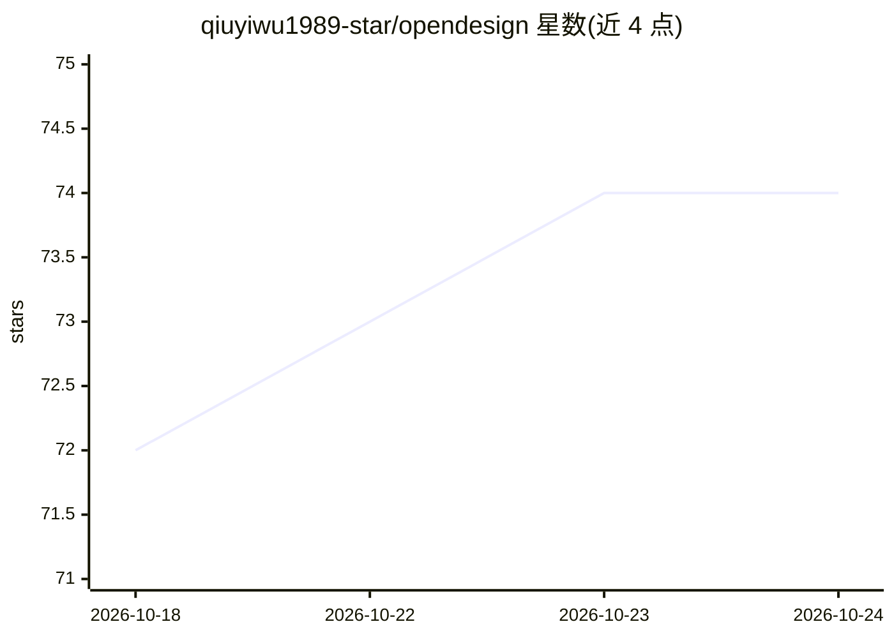

# qiuyiwu1989-star/opendesign

⭐ 74 · JavaScript · NOASSERTION · 推送 2026-08-27 · [GitHub](https://github.com/qiuyiwu1989-star/opendesign) · [官网](https://opendesign.cc) · 个人维护 · 中文 README

**从真实网站提取设计系统，经 MCP 供 AI 编程 Agent 使用**

提供 1,486 个从真实网站测得的设计系统数据集与 MCP 服务器：通过 Playwright 驱动浏览器读取 getComputedStyle，按频率聚合为 colors/typography/spacing 等 6 层实测 token；920 个站点含完整 11 层规格包与可粘贴 systemPrompt。AI 编程 Agent 可通过 7 个 MCP 工具（推荐参考、获取 token、搜索、评审 rubric 等）在生成时获得具体设计值。支持远程与本地 npx 两种接入，任一 MCP 客户端可用，也提供静态 HTTP 端点与人类浏览界面；提取管线可自托管运行。

## 筛选速览

| 维度 | 判定 | 备注 |
|---|---|---|
| AI 角色 | `ai-ecosystem` | LLM/agent 周边工具 |
| 许可风险 | `none` | NOASSERTION |
| 部署形态 | `None` |  |
| 模型依赖 | — | README 未给出锁定关系 |
| 硬件要求 | — | 无带数字的原话,不猜 |
| 安装摩擦 | `low` | 无编译、无系统依赖或容器化 |
| 成熟度 | — | 结构信号不足 |

## 能力要点

- Playwright 实测 DOM 得到 6 层设计 token（1,486 站点）
- 920 个站点含 11 层完整规格包与 systemPrompt
- 7 个 MCP 工具，兼容任意 MCP 客户端，无需账号/API key
- 无 MCP 时可经静态端点（skill.md/catalog.json/llms.txt）获取数据

## 适用场景

- 让 AI 编程 Agent 生成界面时使用真实设计 token 而非泛化风格
- 按设计需求检索并推荐不同美学方向的设计系统参考
- 用自己的网站跑提取管线生成设计规格并自托管

## 场景标签

`网页抓取` · 领域:效率与自动化

## 证据(README 行号)

> L42: { "mcpServers": { "opendesign": { "url": "https://opendesign.cc/mcp/http" } } }
> L51: Works with Claude Desktop, Claude Code, Cursor, Windsurf — any MCP client. No account, no API key, no rate card.
> L61: |`get_design_system`|**The core one.** A site's real grounded tokens|

## 星数曲线

2026-10-18 72 → 2026-10-24 74（+2）

---
*卡片 v1 · prompt 1.4 · 生成 2026-10-24 · 置信度 high · 依据 README sha `5eb5e7403172` · [字段定义](../../DATASET.md)*
