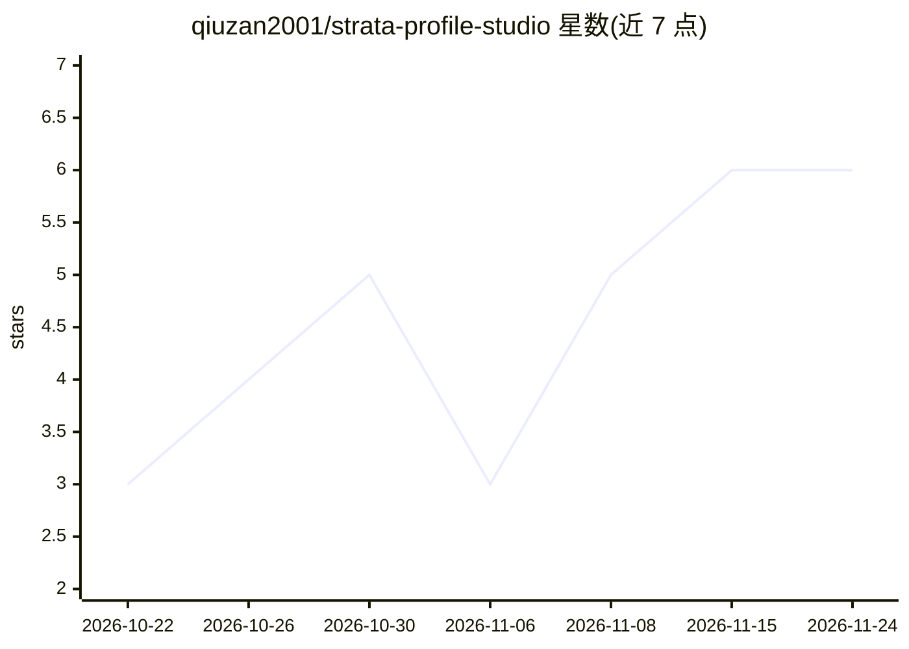

# qiuzan2001/strata-profile-studio

⭐ 7 · Python · MIT · 推送 2026-10-22 · [GitHub](https://github.com/qiuzan2001/strata-profile-studio) · 个人维护

**本地 Strata 推理的性能剖析与调优仪表盘**

以网页形式运行的工具：连接同机运行的 Strata 推理服务，展示每个请求的时间分布与瓶颈部件（GPU、CPU 专家、draft、PCIe、磁盘、RAM、VRAM），记录多轮 profile 运行并按本机噪声底比较调参前后差异。内置校准流程与标准测试调参，仅调整不改变回复内容的设置项，采用 A/A 噪声测量与 95% 区间统计判定。支持 --demo 演示模式、只读模式与 Tailscale 远程访问。

## 筛选速览

| 维度 | 判定 | 备注 |
|---|---|---|
| AI 角色 | `ai-ecosystem` | LLM/agent 周边工具 |
| 许可风险 | `permissive` | MIT |
| 部署形态 | `None` |  |
| 模型依赖 | — | README 未给出锁定关系 |
| 硬件要求 | — | 无带数字的原话,不猜 |
| 安装摩擦 | `medium` | 含编译或系统依赖之一 |
| 成熟度 | — | 结构信号不足 |

## 能力要点

- 实时展示请求时间分布与 PC 部件瓶颈（专家映射、decode 分窗口）
- 以噪声底与 95% 配对区间判定调参是否有效
- 仅调不改答案的设置项，并逐轮对比回复文本防止回归
- 标准库实现，无自有 GPU 依赖，写配置前生成 .bak 备份

## 适用场景

- 排查本地 Strata 推理的时间花在哪个部件
- 调参后验证提升是否超过本机噪声
- 远程通过 Tailscale 查看与管理运行参数

## 场景标签

`LLM 可观测性` · 领域:评测与运维

## 证据(README 行号)

> L21: The Studio is a web page. It shows where the time of each Strata request goes and which part of the PC limits it.
> L22: It also shows whether a change of settings made Strata faster, against the noise of this PC. It needs a running Str
> L3: **See what limits Strata on your PC, tune it, and measure whether the tune

## 星数曲线

2026-10-22 3 → 2026-11-24 6（+3）

---
*卡片 v1 · prompt 1.4 · 生成 2026-11-20 · 置信度 high · 依据 README sha `d3a624147e60` · [字段定义](../../DATASET.md)*
