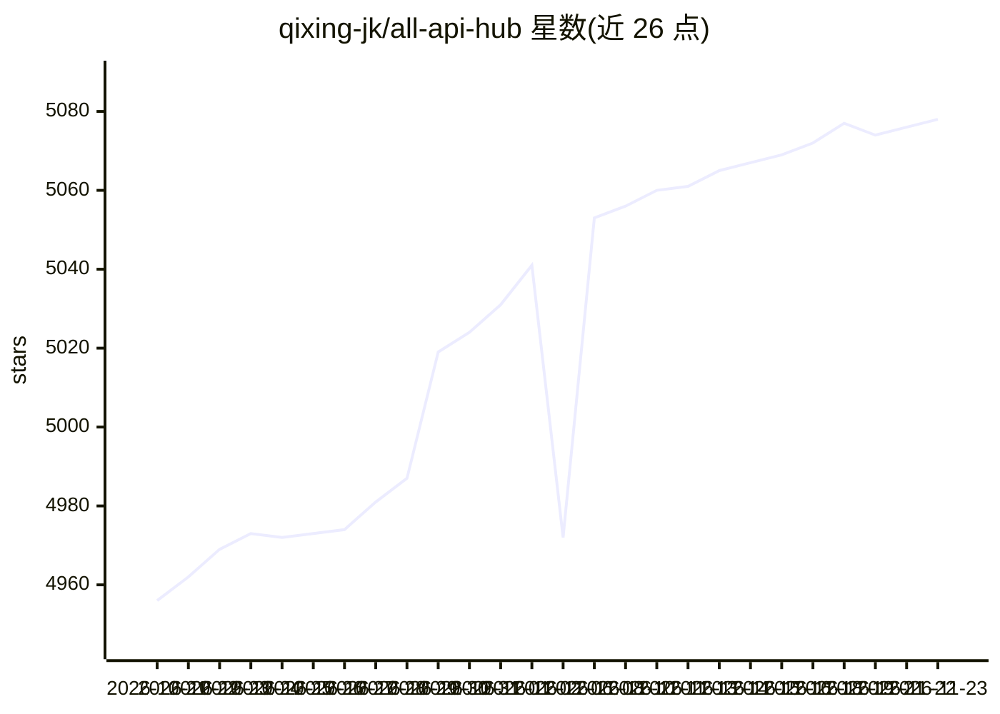

# qixing-jk/all-api-hub

⭐ 5,078 · TypeScript · AGPL-3.0 · 推送 2026-11-22 · [GitHub](https://github.com/qixing-jk/all-api-hub) · [官网](https://all-api-hub.qixing1217.top/) · 个人维护 · 中文 README

**AI 中转站多账号管理浏览器扩展：余额、签到、密钥一站管理**

面向 AI 中转站（New API 兼容站点）用户的浏览器扩展，集中管理多个中转站账号：余额/用量看板与趋势图表、跨站点模型价格对比、多站点自动签到、页面快速抓取 Base URL 与 API Key 并测试可用性，凭证一键导出到 CC Switch、Cherry Studio、Claude Code Router 等客户端。支持管理自建 AI 网关（New API、CLIProxyAPI 等）的渠道与模型同步。数据默认本地存储，可加密 WebDAV 同步。

## 筛选速览

| 维度 | 判定 | 备注 |
|---|---|---|
| AI 角色 | `ai-ecosystem` | LLM/agent 周边工具 |
| 许可风险 | `dual` | AGPL-3.0 |
| 部署形态 | `None` |  |
| 模型依赖 | — | README 未给出锁定关系 |
| 硬件要求 | — | 无带数字的原话,不猜 |
| 安装摩擦 | `low` | 无编译、无系统依赖或容器化 |
| 成熟度 | — | 结构信号不足 |

## 能力要点

- 多中转站账号余额、用量与状态统一看板
- 跨站点同模型价格对比与多站点定时自动签到
- 页面抓取 API Key、一键连通性与模型可用性测试
- 管理自建 AI 网关渠道，模型列表同步与自定义重定向

## 适用场景

- 我有多个中转站账号，想在一个面板查看余额和用量
- 每天签到领奖励太麻烦，想定时自动签到
- 想把收集到的 API Key 快速测试并导入 Cherry Studio 等客户端
- 自建了 New API 网关，想在扩展里直接管理渠道和模型

## 场景标签

 · 领域:开发者工具/API 账号管理

## 证据(README 行号)

> L5: **One-stop management for New API-compatible relay accounts: balances, usage, model prices, check-ins, API credentia
> L78: - **Manage Popular AI Gateways in One Place**: Manage OmniRoute, CLIProxyAPI, New API, Sub2API, Magpie, gpt-load, A
> L64: - **One-Click Client Export**: Send credentials to CC Switch, Cherry Studio, Claude Code Router, Kilo Code, Roo Cod

## 星数曲线

2026-10-21 4,956 → 2026-11-23 5,078（+122）

---
*卡片 v1 · prompt 1.4 · 生成 2026-11-23 · 置信度 high · 依据 README sha `3207b4e3eade` · [字段定义](../../DATASET.md)*
