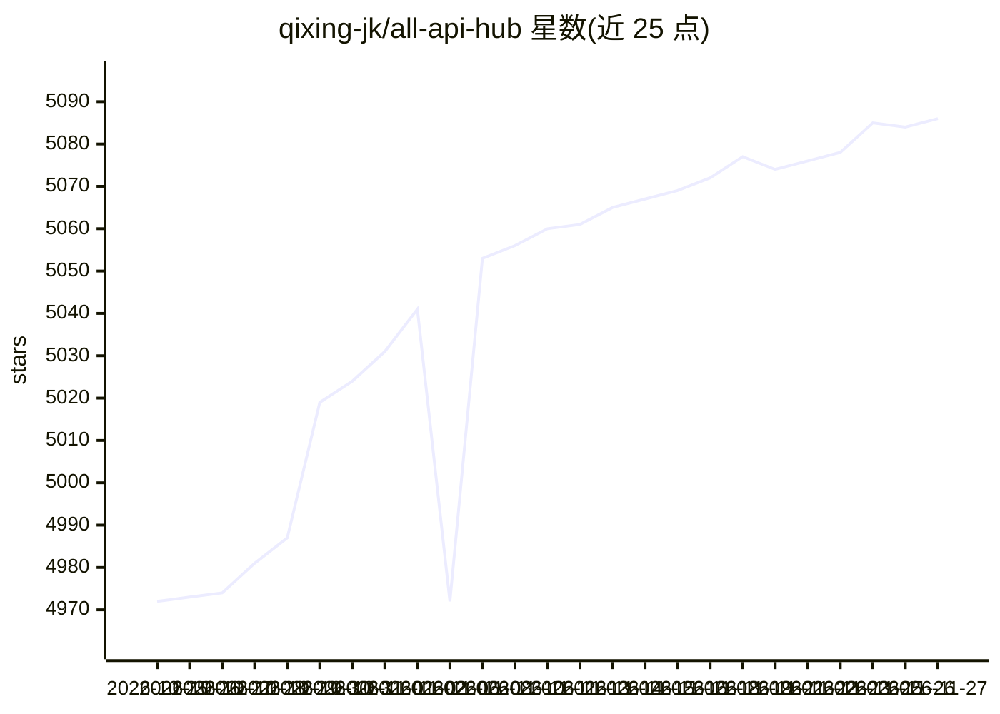

# qixing-jk/all-api-hub

⭐ 5,086 · TypeScript · AGPL-3.0 · 推送 2026-11-26 · [GitHub](https://github.com/qixing-jk/all-api-hub) · [官网](https://all-api-hub.qixing1217.top/) · 个人维护 · 中文 README

**浏览器扩展：统一管理多个 AI 中转站账号的余额、签到与密钥**

面向使用多个 AI 中转/网关站点用户的浏览器扩展（Chrome/Edge/Firefox 商店分发）：聚合各站点余额、用量与公告，跨站对比模型价格，支持定时自动签到、页面快速抓取 Base URL 与 API Key 并入凭证库、一键连通性与模型可用性测试。可将凭证一键导出到 CC Switch、Cherry Studio、Claude Code Router 等客户端，并支持在扩展内管理 OmniRoute、New API、Sub2API 等自托管网关的渠道与模型同步/重定向。数据默认本地存储，可加密 WebDAV 同步。

## 筛选速览

| 维度 | 判定 | 备注 |
|---|---|---|
| AI 角色 | `ai-ecosystem` | LLM/agent 周边工具 |
| 许可风险 | `dual` | AGPL-3.0 |
| 部署形态 | `None` |  |
| 模型依赖 | — | README 未给出锁定关系 |
| 硬件要求 | — | 无带数字的原话,不猜 |
| 安装摩擦 | `low` | 无编译、无系统依赖或容器化 |
| 成熟度 | — | 结构信号不足 |

## 能力要点

- 多站点余额/用量统一看板与趋势图表
- 多站点一键或定时自动签到与任务结果提醒
- 跨站模型价格对比与页面快速抓取凭证
- 凭证一键导出到 CC Switch、Cherry Studio、Claude Code Router、Kilo Code 等工具

## 适用场景

- 我同时用多个中转站，想在一个面板看余额和用量
- 每天签到太麻烦，想定时自动签到领奖励
- 同一个模型想比价，挑更划算的端点
- 把抓到的 API Key 快速导入我常用的客户端工具

## 场景标签

`浏览器自动化` · 领域:效率与自动化

## 证据(README 行号)

> L5: **One-stop management for New API-compatible relay accounts: balances, usage, model prices, check-ins, API credentia
> L78: - **Manage Popular AI Gateways in One Place**: Manage OmniRoute, CLIProxyAPI, New API, Sub2API, Magpie, gpt-load, A

## 星数曲线

2026-10-25 4,972 → 2026-11-27 5,086（+114）

---
*卡片 v1 · prompt 1.4 · 生成 2026-11-24 · 置信度 high · 依据 README sha `fda936e74100` · [字段定义](../../DATASET.md)*
