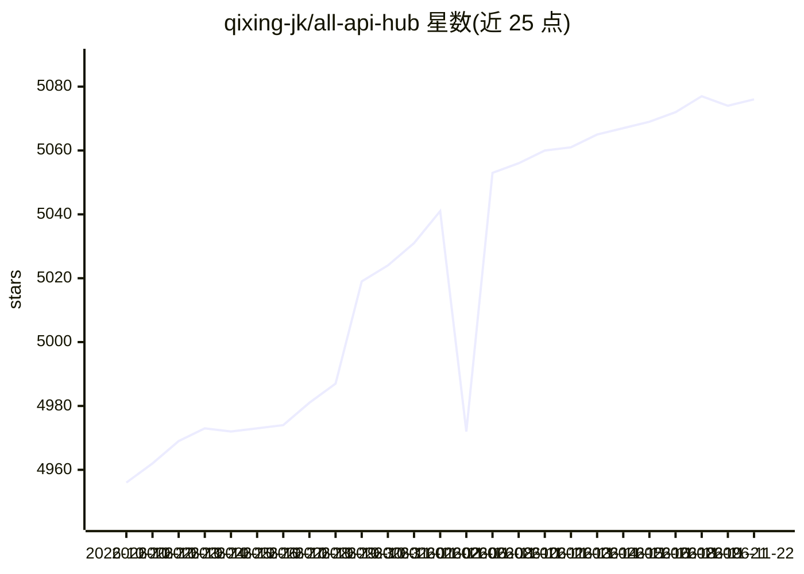

# qixing-jk/all-api-hub

⭐ 5,076 · TypeScript · AGPL-3.0 · 推送 2026-11-21 · [GitHub](https://github.com/qixing-jk/all-api-hub) · [官网](https://all-api-hub.qixing1217.top/) · 组织维护 · 中文 README

**浏览器扩展：一站式管理多个 AI 中转站账号与密钥**

面向同时使用多个 New API/Sub2API 兼容中转站的用户，提供统一看板查看余额、用量与账号状态，支持跨站模型价格对比、多站自动签到、页面快速抓取 Base URL/Key 并入库，一键导出到 CC Switch、Cherry Studio 等客户端，并可对自托管 AI 网关（New API、CLIProxyAPI 等）做渠道创建与模型同步。数据默认本地存储，支持加密 WebDAV 同步。通过 Chrome/Edge/Firefox 应用商店或 GitHub 手动安装，Safari 需 Xcode 编译。

## 筛选速览

| 维度 | 判定 | 备注 |
|---|---|---|
| AI 角色 | `ai-ecosystem` | LLM/agent 周边工具 |
| 许可风险 | `dual` | AGPL-3.0 |
| 部署形态 | `None` |  |
| 模型依赖 | — | README 未给出锁定关系 |
| 硬件要求 | — | 无带数字的原话,不猜 |
| 安装摩擦 | `low` | 无编译、无系统依赖或容器化 |
| 成熟度 | — | 结构信号不足 |

## 能力要点

- 多中转站余额、用量、模型价格的统一看板与趋势图
- 多站自动签到与浏览器/通知渠道的结果提醒
- 页面快速抓取 API 凭证并一键导出到 CC Switch、Cherry Studio 等工具
- 管理 New API、CLIProxyAPI 等自托管网关的渠道与模型同步/重定向

## 适用场景

- 集中查看分散在多个中转站的余额和用量
- 定时自动签到领取每日奖励
- 同一模型在不同站点间比价后一键切换端点
- 统一管理自部署 AI 网关的渠道配置

## 场景标签

 · 领域:AI 基础设施/账号与密钥管理工具

## 证据(README 行号)

> L5: **One-stop management for New API-compatible relay accounts: balances, usage, model prices, check-ins, API credentia
> L46: **All API Hub is your AI asset manager**: add your site URLs and let the extension handle the rest.
> L78: - **Manage Popular AI Gateways in One Place**: Manage OmniRoute, CLIProxyAPI, New API, Sub2API, Magpie, gpt-load, A

## 星数曲线

2026-10-20 4,956 → 2026-11-22 5,076（+120）

---
*卡片 v1 · prompt 1.4 · 生成 2026-11-22 · 置信度 high · 依据 README sha `feeac7542eb6` · [字段定义](../../DATASET.md)*
