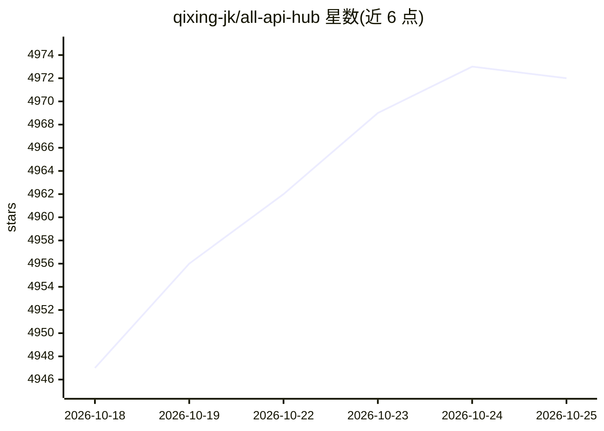

# qixing-jk/all-api-hub

⭐ 4,972 · TypeScript · AGPL-3.0 · 推送 2026-10-24 · [GitHub](https://github.com/qixing-jk/all-api-hub) · [官网](https://all-api-hub.qixing1217.top/) · 个人维护 · 中文 README

**浏览器扩展：一站式管理 New API 等中转站账号与密钥资产**

面向使用 AI 中转站/自建网关用户的浏览器扩展（Chrome/Edge/Firefox）：统一查看多站点余额与用量、跨站模型价格对比、多站点自动签到、网页快速抓取 Base URL 与 API Key、一键导出密钥到 CC Switch/Cherry Studio 等客户端，并可集中管理 New API/Sub2API/CLIProxyAPI 等自建网关的渠道、模型同步与重定向。数据默认本地存储，可选加密 WebDAV 同步。注意 README 大篇幅为赞助商推广内容。

## 筛选速览

| 维度 | 判定 | 备注 |
|---|---|---|
| AI 角色 | `ai-ecosystem` | LLM/agent 周边工具 |
| 许可风险 | `dual` | AGPL-3.0 |
| 部署形态 | `None` |  |
| 模型依赖 | — | README 未给出锁定关系 |
| 硬件要求 | — | 无带数字的原话,不猜 |
| 安装摩擦 | `low` | 无编译、无系统依赖或容器化 |
| 成熟度 | `idea` | |

## 能力要点

- 多站点余额/用量统一看板与趋势分析
- 跨站模型价格对比与多站点定时自动签到
- 凭据库一键导出到 CC Switch/Cherry Studio 等 8+ 客户端工具
- 集中管理 New API/Sub2API 等自建网关渠道与模型同步/重定向

## 适用场景

- 我在多个 AI 中转站有账号，想在一个页面看余额和用量
- 我想自动完成各站点的每日签到并对比同款模型价格
- 我把收集到的 API Key 统一保存并测试可用性后导入常用客户端
- 我在扩展内直接管理自建 New API 网关的渠道和模型列表

## 场景标签

 · 领域:LLM 基础设施/API 管理

## 证据(README 行号)

> L5: **One-stop management for New API-compatible relay accounts: balances, usage, model prices, check-ins, API credentia
> L78: - **Manage Popular AI Gateways in One Place**: Manage OmniRoute, CLIProxyAPI, New API, Sub2API, Magpie, gpt-load, A

## 星数曲线

2026-10-18 4,947 → 2026-10-25 4,972（+25）

---
*卡片 v1 · prompt 1.4 · 生成 2026-10-20 · 置信度 high · 依据 README sha `56348d943570` · [字段定义](../../DATASET.md)*
