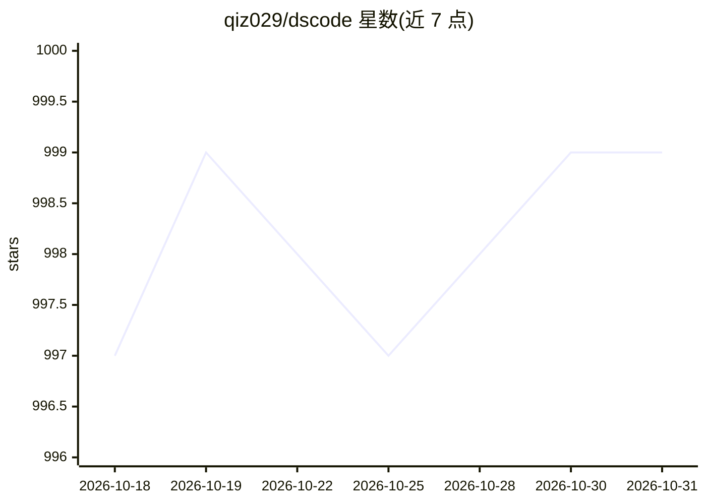

# qiz029/dscode

⭐ 999 · JavaScript · MIT · 推送 2026-10-28 · [GitHub](https://github.com/qiz029/dscode) · [官网](https://www.npmjs.com/package/@toddzheng024/dscode) · 个人维护 · 中文 README

**面向 macOS/Linux 的终端编码 agent，基于 DeepSeek Harness**

DSCODE 是运行于 macOS 与 Linux 终端的编码 agent，构建在 DeepSeek Harness（DSH）之上：提供带文件版本校验的读写工具、持久 shell、后台 host 进程（关闭终端不中断任务）、远程运行时（TCP+token，未加密需 VPN/LAN/SSH 隧道）、跨会话消息传递与 agent 间任务委派、独立模型代码审查、Ultra 子 agent（隔离 Git worktree）、跨会话记忆与非交互 exec 模式（支持 CI）。以自包含软件包与 curl 安装器分发，含内置 Node.js 运行时，依赖整体版本化校验。

## 筛选速览

| 维度 | 判定 | 备注 |
|---|---|---|
| AI 角色 | `ai-native` | 本体是模型或模型工具 |
| 许可风险 | `permissive` | MIT |
| 部署形态 | `None` |  |
| 模型依赖 | locked-api |  |
| 硬件要求 | — | 无带数字的原话,不猜 |
| 安装摩擦 | `low` | 无编译、无系统依赖或容器化 |
| 成熟度 | — | 结构信号不足 |

## 能力要点

- 终端与 agent 运行时分离的后台 host，多终端共享会话且崩溃可重连
- agent 间任务委派：子 agent 在隔离 Git worktree 中运行，Ultra 级别可并发 20 个
- 独立只读模型执行代码审查与权限自动审批
- 远程运行时将工具、文件与凭据保留在服务器端

## 适用场景

- 在终端中让 agent 读写代码、跑构建与测试的日常编码
- 多个终端/多个 agent 会话之间移交与审查任务
- 把编码任务接入脚本与 CI 的非交互执行

## 场景标签

`编码 Agent` `代码审查` · 领域:编码与开发

## 证据(README 行号)

> L22: DSCODE is a terminal coding agent for macOS and Linux, built on DeepSeek Harness. Dedicated file tools read and edi
> L41: |**Background host**|The terminal and the agent runtime run as separate processes: the first `dscode` starts a loca
> L49: |**Non-interactive runs**|`dscode exec "prompt"`, or `git diff \|dscode exec "review this"`, runs a full turn in sc

## 星数曲线

2026-10-18 997 → 2026-10-31 999（+2）

---
*卡片 v1 · prompt 1.4 · 生成 2026-10-21 · 置信度 high · 依据 README sha `9feed07ea6e0` · [字段定义](../../DATASET.md)*
