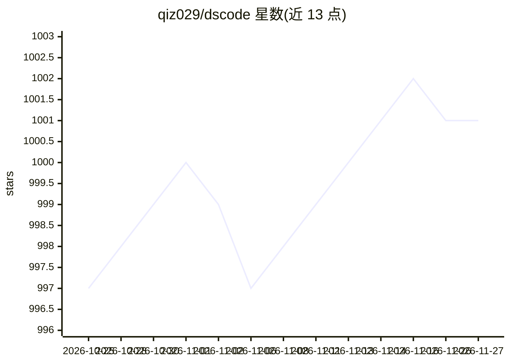

# qiz029/dscode

⭐ 1,001 · JavaScript · MIT · 推送 2026-11-25 · [GitHub](https://github.com/qiz029/dscode) · [官网](https://www.npmjs.com/package/@toddzheng024/dscode) · 个人维护 · 中文 README

**终端里的 DeepSeek 编码 agent：会话桥接与子代理协作**

面向 macOS 与 Linux 的终端编码 agent，基于 DeepSeek Harness 构建。提供带版本检查的文件读写工具、持久化 Bash shell、TUI/CLI/脚本共享同一会话运行时，安装为固定版本的可复现 harness。特色机制包括：跨会话任务传递与邮箱、独立只读模型做代码审查与权限审批、Ultra 子代理委托与隔离 Git worktree、后台主机进程与远程服务器运行时、非交互式 exec 供 CI 调用。要求 macOS 14+ 或 glibc Linux，自带 Node.js，远程连接未加密需 VPN/SSH 隧道。

## 筛选速览

| 维度 | 判定 | 备注 |
|---|---|---|
| AI 角色 | `ai-native` | 本体是模型或模型工具 |
| 许可风险 | `permissive` | MIT |
| 部署形态 | `None` |  |
| 模型依赖 | locked-api |  |
| 硬件要求 | — | 无带数字的原话,不猜 |
| 安装摩擦 | `low` | 无编译、无系统依赖或容器化 |
| 成熟度 | — | 结构信号不足 |

## 能力要点

- 会话间任务传递：list/send/read_session 等工具与持久化邮箱
- 独立审查模型审批权限与代码 diff，可切换人工审批
- 后台主机进程：终端崩溃后会话存活，多终端共享会话
- dscode exec 非交互运行完整回合，支持 --json 与 CI 集成

## 适用场景

- 在终端里用 DeepSeek 进行代码编辑、构建与测试
- 让多个 agent 会话相互移交任务并交叉审查改动
- 在 CI 脚本中以非交互方式运行代码审查
- 把运行时部署到服务器，本地终端远程连接使用

## 场景标签

`编码 Agent` `代码审查` · 领域:编码与开发

## 证据(README 行号)

> L22: DSCODE is a terminal coding agent for macOS and Linux, built on DeepSeek Harness. Dedicated file tools read and edi
> L44: |**Agent-to-agent tasks**|The agent finds, reads and messages other sessions with `list_sessions`, `read_session`, 

## 星数曲线

2026-10-25 997 → 2026-11-27 1,001（+4）

---
*卡片 v1 · prompt 1.4 · 生成 2026-11-24 · 置信度 high · 依据 README sha `d11a2e3031af` · [字段定义](../../DATASET.md)*
