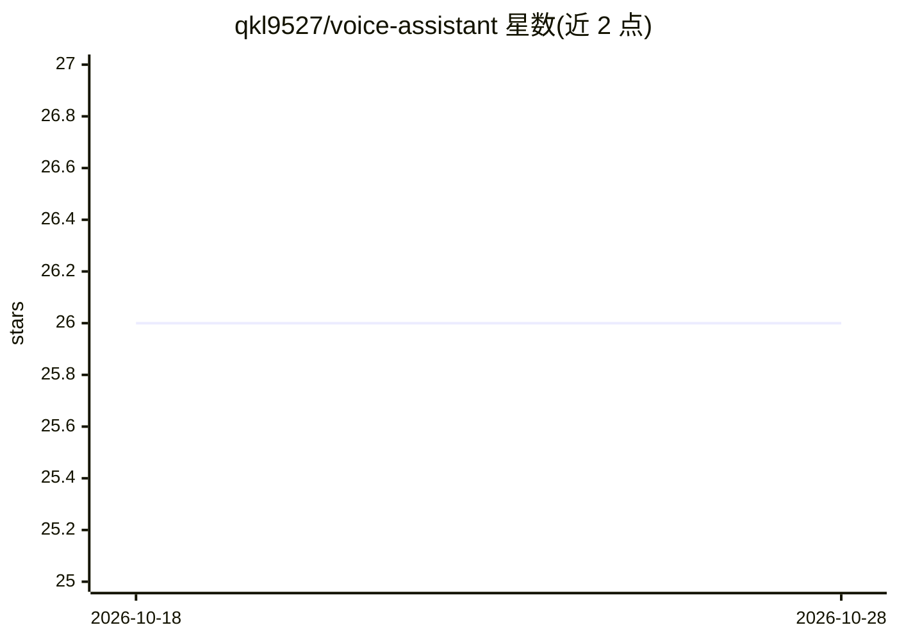

# qkl9527/voice-assistant

⭐ 26 · Python · 推送 2025-12-18 · [GitHub](https://github.com/qkl9527/voice-assistant) · 个人维护 · 中文 README

**基于 FunASR 的跨平台实时语音识别桌面应用，供普通用户**

Electron+Vue3 前端与 Python/Flask 后端构成的桌面应用，内置 FunASR 模型：首次启动自动下载模型，录音后实时转写文本，可将结果自动插入系统当前焦点位置，并管理历史记录；另集成 AI 文本处理功能（错别字修正、概述、润色、翻译）。Windows/macOS 提供安装包，Linux 需按教程源码运行；README 自述实时转录效果尚待优化，GPU 支持仍在规划中。

## 筛选速览

| 维度 | 判定 | 备注 |
|---|---|---|
| AI 角色 | `ai-native` | 本体是模型或模型工具 |
| 许可风险 | `none` | — |
| 部署形态 | `desktop` | 安装包/桌面程序 |
| 模型依赖 | — | README 未给出锁定关系 |
| 硬件要求 | — | 无带数字的原话,不猜 |
| 安装摩擦 | `medium` | 含编译或系统依赖之一 |
| 成熟度 | `idea` | |

## 能力要点

- 基于 FunASR 的实时语音识别，首次启动自动下载模型
- 识别文本可自动插入到系统当前焦点位置
- AI 文本处理：错别字修正、概述、润色、翻译
- Windows/macOS 提供安装包，Linux 可从源码运行

## 适用场景

- 用语音输入替代打字，识别结果直接插入任意应用
- 对语音内容做记录并管理历史
- 对识别文本做修正、翻译、概述等 AI 处理

## 场景标签

`语音识别` · 领域:感知与多模态

## 证据(README 行号)

> L3: 基于 FunASR 的跨平台[实时]AI 语音识别桌面应用，支持 Windows、macOS 和 Linux。
> L19: - 实时 AI 语音识别, 基于 FunASR 的高精度语音识别
> L46:  - [x] 增加 AI 处理文字功能：错别字修正、概述、润色、翻译等

## 星数曲线

2026-10-18 26 → 2026-10-28 26（+0）

---
*卡片 v1 · prompt 1.4 · 生成 2026-10-26 · 置信度 high · 依据 README sha `2d23fb87f2c1` · [字段定义](../../DATASET.md)*
