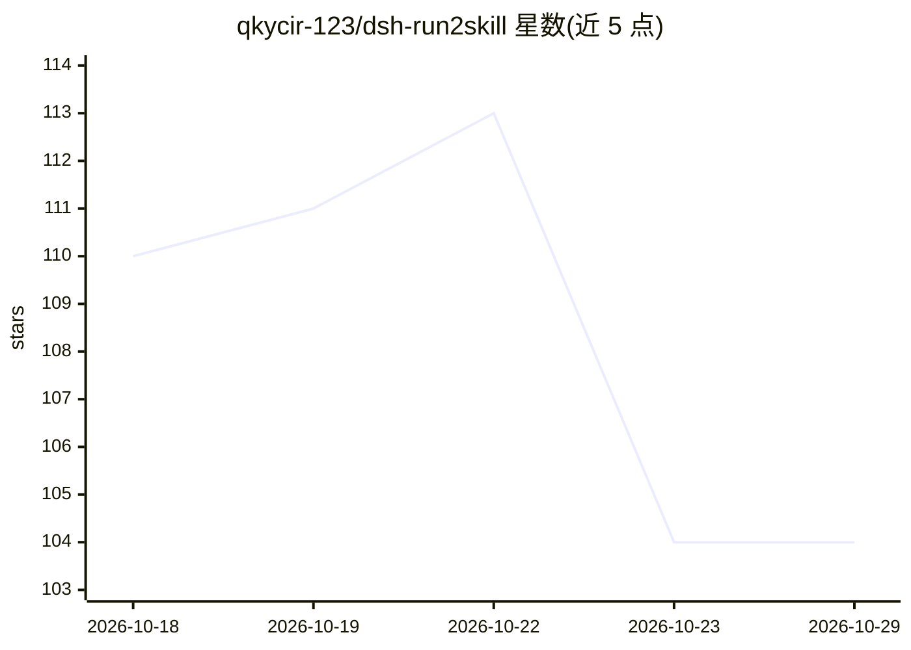

# qkycir-123/dsh-run2skill

⭐ 104 · TypeScript · MIT · 推送 2026-10-20 · [GitHub](https://github.com/qkycir-123/dsh-run2skill) · 个人维护 · 中文 README

**DSH 插件：把成功会话经验自动整理为可复用 Skill**

面向 DeepSeek Harness（DSH）的插件：在会话空闲或收到保存请求时，把用户教给 Agent 的纠正、约束与工作流整理成 Skill 草稿，附对话来源供审核，可确认保存到当前项目或所有项目，使用 DSH 默认 Skill 目录。草稿在本地管理，仅将筛选脱敏后的必要对话片段交给当前会话模型分析。通过 dsh plugin 命令安装，支持 Desktop 与 Web 两种 profile，已发布版本适配 DSH 0.2.0-rc.2。

## 筛选速览

| 维度 | 判定 | 备注 |
|---|---|---|
| AI 角色 | `ai-ecosystem` | LLM/agent 周边工具 |
| 许可风险 | `permissive` | MIT |
| 部署形态 | `None` |  |
| 模型依赖 | locked-api |  |
| 硬件要求 | — | 无带数字的原话,不猜 |
| 安装摩擦 | `low` | 无编译、无系统依赖或容器化 |
| 成熟度 | `idea` | |

## 能力要点

- 会话空闲或显式请求时自动整理经验为 Skill 草稿
- 草稿附对话来源，支持确认保存/要求修改/放弃
- Skill 可保存到当前项目或所有项目，沿用 DSH Skill 目录
- 草稿本地管理，仅提交筛选脱敏后的必要片段给当前模型

## 适用场景

- 把反复教 Agent 的纠正和约束沉淀为可复用 Skill
- 审核 Agent 自动生成的技能草稿再决定是否保存
- 在多个项目间复用同一套工作流 Skill

## 场景标签

`提示工程` `Agent 记忆` · 领域:Agent 开发

## 证据(README 行号)

> L12: Run2Skill 把你在 DeepSeek Harness（DSH）里教给 Agent 的纠正、约束和工作流，整理成可复用的 Skill。你查看草稿、提出修改意见，确认后保存。
> L62: Run2Skill 在会话空闲或收到保存请求时整理经验。有草稿需要审核时，DSH 会通知你。也可以打开插件页，点击**立即整理本次经验**。

## 星数曲线

2026-10-18 110 → 2026-10-29 104（-6）

---
*卡片 v1 · prompt 1.4 · 生成 2026-10-23 · 置信度 high · 依据 README sha `d8ef2a6f27c2` · [字段定义](../../DATASET.md)*
