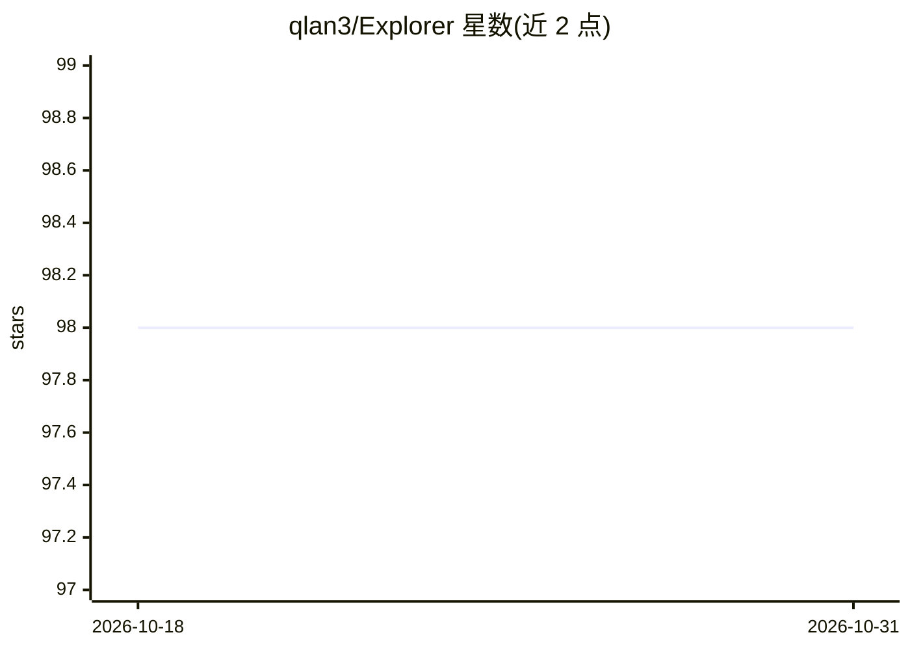

# qlan3/Explorer

⭐ 98 · Python · MIT · 推送 2026-07-17 · [GitHub](https://github.com/qlan3/Explorer) · 个人维护

**PyTorch 强化学习研究框架：多种 DQN/PPO/SAC 算法实现与实验管理**

面向强化学习研究者的 PyTorch 框架，实现 VanillaDQN、DQN 系列（DDQN、MaxminDQN、BootstrappedDQN、NoisyNetDQN、MeDQN 等）与策略梯度系列（REINFORCE、Actor-Critic、PPO、SAC、DDPG、TD3、RPG）共 16 种算法，agent 类按依赖树组织。实验由 configs 目录下的配置文件驱动，通过配置索引生成配置并运行，日志与模型保存到 logs；支持 GNU Parallel 批量调度多次运行。环境支持 Gym classic_control/box2d，可选 Atari、MuJoCo（需 1.50 版本与激活密钥）、PyBullet、DeepMind Control Suite。仓库声明不再积极维护，指向 Jax 实现 Jaxplorer。

## 筛选速览

| 维度 | 判定 | 备注 |
|---|---|---|
| AI 角色 | `ai-native` | 本体是模型或模型工具 |
| 许可风险 | `permissive` | MIT |
| 部署形态 | `library` | 以包/库形式分发 |
| 模型依赖 | — | README 未给出锁定关系 |
| 硬件要求 | — | 无带数字的原话,不猜 |
| 安装摩擦 | `low` | 无编译、无系统依赖或容器化 |
| 成熟度 | — | 结构信号不足 |

## 能力要点

- 16 种强化学习算法实现（DQN 系列与策略梯度系列）
- 配置文件 + 配置索引驱动的实验与网格搜索流程
- 支持 Gym/Atari/MuJoCo/PyBullet/DMC 多类环境
- 支持 Parallel 批量调度多次实验运行

## 适用场景

- 我在研究新强化学习算法时需要一个可扩展的基线实现集合
- 我要跑配置网格搜索并批量调度多次实验
- 我在多个经典控制与连续控制环境上对比算法

## 场景标签

`强化学习` · 领域:训练与推理

## 证据(README 行号)

> L3: Explorer is a PyTorch reinforcement learning framework for **exploring** new ideas.
> L8: ## Implemented algorithms

## 星数曲线

2026-10-18 98 → 2026-10-31 98（+0）

---
*卡片 v1 · prompt 1.4 · 生成 2026-10-23 · 置信度 mid · 依据 README sha `32f50cce2e3a` · [字段定义](../../DATASET.md)*
