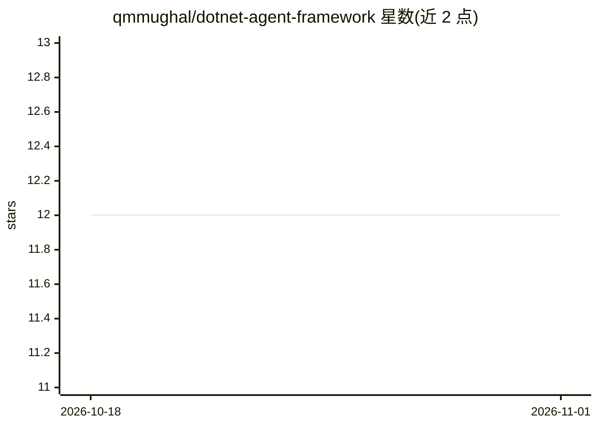

# qmmughal/dotnet-agent-framework

⭐ 12 · C# · MIT · 推送 2026-07-23 · [GitHub](https://github.com/qmmughal/dotnet-agent-framework) · 个人维护

**.NET 8 多智能体编排框架：C# 构建自主 Agent 与 RAG 工作流**

面向 .NET 生态的多智能体编排框架，提供 C# 原生抽象：以 Role/Goal/Backstory 定义 Agent 并挂载 ITool 工具，通过 SequentialWorkflow 串联多 Agent 并传递上下文、记忆与状态；内置 IVectorStore 接口与 InMemoryVectorStore 示例支持 RAG。LLM 后端通过 ILlmProvider 接口切换（OpenAI、Semantic Kernel、本地 Ollama）。定位为 CrewAI/LangChain 等 Python 工具在 .NET 企业系统中的替代方案。以 NuGet 包形式发布四个库项目。

## 筛选速览

| 维度 | 判定 | 备注 |
|---|---|---|
| AI 角色 | `ai-ecosystem` | LLM/agent 周边工具 |
| 许可风险 | `permissive` | MIT |
| 部署形态 | `None` |  |
| 模型依赖 | local-ok | 支持本地模型 |
| 硬件要求 | — | 无带数字的原话,不猜 |
| 安装摩擦 | `medium` | 含编译或系统依赖之一 |
| 成熟度 | — | 结构信号不足 |

## 能力要点

- ILlmProvider 接口可切换 LLM 后端（OpenAI/Semantic Kernel/Ollama）
- SequentialWorkflow 串联多 Agent 并传递上下文、记忆与状态
- 内置 IVectorStore 与 InMemoryVectorStore，支持 RAG 工作流
- 四个库项目（Core/Memory/Orchestration/Providers.OpenAI）以 NuGet 包发布

## 适用场景

- 在 .NET 企业系统中用 C# 构建多智能体工作流
- 给 Agent 挂载搜索、API、数据库工具执行任务
- 在 .NET 项目中快速搭建 RAG 检索问答流程

## 场景标签

`Agent 框架` `多智能体` `RAG` · 领域:Agent 开发

## 证据(README 行号)

> L6: A lightweight, enterprise-ready multi-agent orchestration framework designed for the .NET ecosystem.
> L14: - **Extensible Orchestration**: Chain agents together via `SequentialWorkflow` to pass conversational context, memo
> L15: - **LLM Agnostic**: The `ILlmProvider` interface makes it trivial to swap backends (OpenAI, Semantic Kernel, local 

## 星数曲线

2026-10-18 12 → 2026-11-01 12（+0）

---
*卡片 v1 · prompt 1.4 · 生成 2026-11-01 · 置信度 high · 依据 README sha `2539cb9db701` · [字段定义](../../DATASET.md)*
