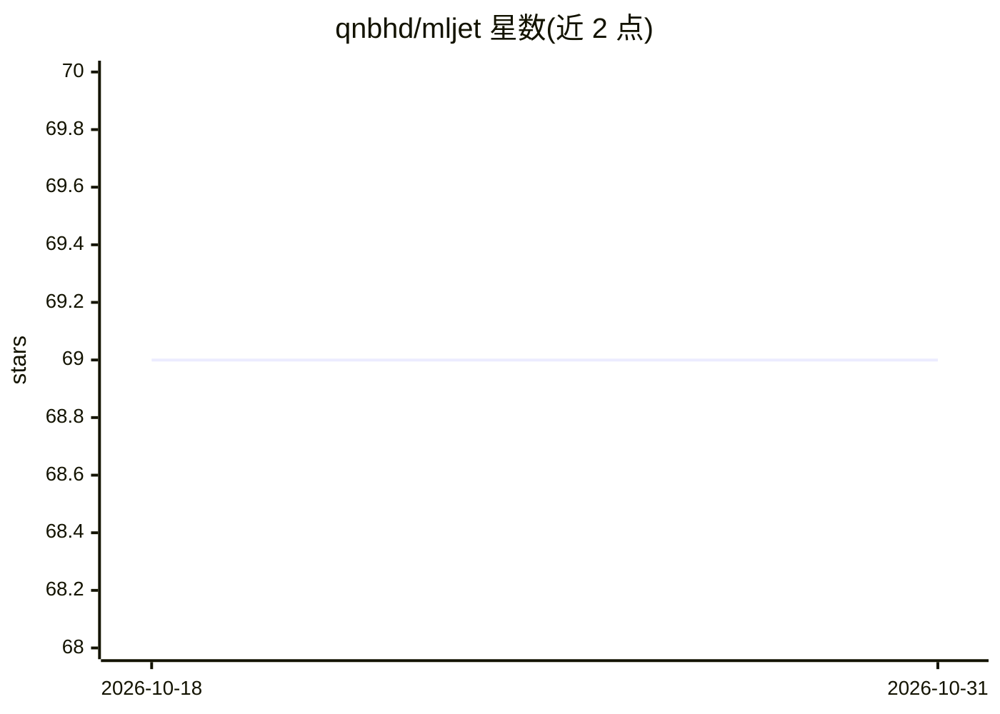

# qnbhd/mljet

⭐ 69 · Python · MIT · 推送 2026-09-19 · [GitHub](https://github.com/qnbhd/mljet) · 个人维护

**一行代码将 ML 模型自动打包为 Docker 服务的部署工具**

面向需要在 hackathon 或演示场景中部署机器学习模型的数据科学家：自动序列化模型（Joblib/Pickle）、基于模板生成含端点处理器的 .py 服务文件（Sanic/Flask 模板）、生成 Dockerfile、编译 API 文档，最终构建 Docker 容器或 Python 包，可部署到 Kubernetes 或 Heroku。支持 sklearn、xgboost、catboost、lightgbm、LightAutoML 模型。本地运行要求 Docker 与 Python >= 3.8。项目曾用名 DeployMe，旧名 PyPI 发布已停止。

## 筛选速览

| 维度 | 判定 | 备注 |
|---|---|---|
| AI 角色 | `ai-ecosystem` | LLM/agent 周边工具 |
| 许可风险 | `permissive` | MIT |
| 部署形态 | `self-host` | docker 或自建部署 |
| 模型依赖 | — | README 未给出锁定关系 |
| 硬件要求 | — | 无带数字的原话,不猜 |
| 安装摩擦 | `low` | 无编译、无系统依赖或容器化 |
| 成熟度 | — | 结构信号不足 |

## 能力要点

- 一行代码完成模型序列化、服务生成、Docker 构建全流程
- 基于模板生成端点处理器（Sanic/Flask）并自动编译 API 文档
- 支持 sklearn/xgboost/catboost/lightgbm/LightAutoML 五类模型
- 产出 Docker 容器或 Python 包，可部署至 Kubernetes/Heroku

## 适用场景

- 快速把训练好的 sklearn/xgboost 等模型变成可访问的预测服务
- hackathon 或向管理层演示时省去手写 Flask 包装的时间
- 需要带 Swagger UI 的模型预测 API 用于测试请求

## 场景标签

`MLOps` · 领域:训练与推理

## 证据(README 行号)

> L20: Our tool automatically collects all the necessary files and dependencies, creates a docker container, and launches 
> L29: 6. After these steps, we build a Docker container, or a Python package, or we just leave the final directory and th

## 星数曲线

2026-10-18 69 → 2026-10-31 69（+0）

---
*卡片 v1 · prompt 1.4 · 生成 2026-10-24 · 置信度 mid · 依据 README sha `75b617b564ce` · [字段定义](../../DATASET.md)*
