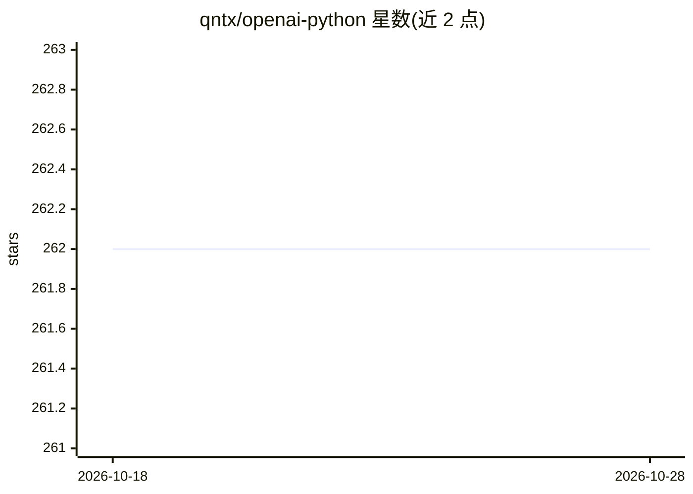

# qntx/openai-python

⭐ 262 · Python · MIT · 推送 2026-10-26 · [GitHub](https://github.com/qntx/openai-python) · [官网](https://pypi.org/project/x402-openai/) · 个人维护

**带 x402 透明支付支持的 OpenAI Python 客户端替换库**

以 MIT 许可发布的 Python 客户端库，定位为 OpenAI 官方 Python 客户端的 drop-in 替代品，在保持原有接口的同时加入 x402 协议的透明支付支持，主题标签涉及 agent、ethereum、solana、web3 等。README 仅含一句定位描述与许可声明，未给出安装命令、使用示例或支付机制细节，具体功能与限制无法从现有内容核验。

## 筛选速览

| 维度 | 判定 | 备注 |
|---|---|---|
| AI 角色 | `ai-ecosystem` | LLM/agent 周边工具 |
| 许可风险 | `permissive` | MIT |
| 部署形态 | `None` |  |
| 模型依赖 | — | README 未给出锁定关系 |
| 硬件要求 | — | 无带数字的原话,不猜 |
| 安装摩擦 | `low` | 无编译、无系统依赖或容器化 |
| 成熟度 | — | 结构信号不足 |

## 能力要点

- OpenAI Python 客户端的 drop-in 替代
- 内置 x402 透明支付支持

## 适用场景

- 在 OpenAI API 调用中接入 x402 支付通道
- 为 web3/加密支付场景的 LLM 应用提供客户端

## 场景标签

`模型网关` · 领域:Agent 开发

## 证据(README 行号)

> L3: Drop-in OpenAI Python client with transparent x402 payment support.

## 星数曲线

2026-10-18 262 → 2026-10-28 262（+0）

---
*卡片 v1 · prompt 1.4 · 生成 2026-10-22 · 置信度 low · 依据 README sha `e31aaa1ebfc7` · [字段定义](../../DATASET.md)*
