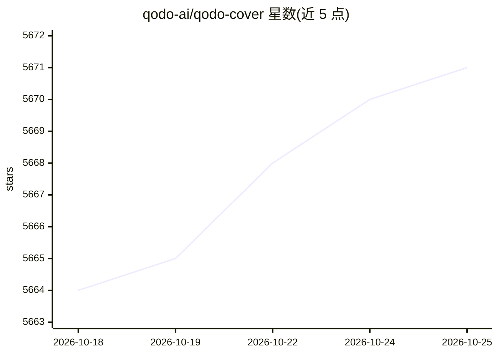

# qodo-ai/qodo-cover

⭐ 5,674 · Python · AGPL-3.0 · 推送 2026-04-05 · [GitHub](https://github.com/qodo-ai/qodo-cover) · [官网](https://qodo.ai/) · 组织维护

**自动生成单元测试以提升代码覆盖率的 AI CLI/CI 工具**

面向开发者的测试生成工具：读取源文件与测试文件，运行测试套件并解析 Cobertura XML 覆盖率报告，构建提示词调用 LLM 生成新测试，再执行验证覆盖率是否提升。可在 GitHub CI 工作流或本地作为 CLI（cover-agent）运行，通过 LiteLLM 支持 OpenAI 及其他 100+ 模型，含 LLM 响应录制回放模式。注意：仓库已声明不再维护。

## 筛选速览

| 维度 | 判定 | 备注 |
|---|---|---|
| AI 角色 | `ai-native` | 本体是模型或模型工具 |
| 许可风险 | `viral` | AGPL-3.0 |
| 部署形态 | `desktop` | 安装包/桌面程序 |
| 模型依赖 | — | README 未给出锁定关系 |
| 硬件要求 | — | 无带数字的原话,不猜 |
| 安装摩擦 | `low` | 无编译、无系统依赖或容器化 |
| 成熟度 | — | 结构信号不足 |

## 能力要点

- Test Runner + Coverage Parser + Prompt Builder + AI Caller 四组件流程
- 通过 LiteLLM 支持 OpenAI 与 100+ 其他 LLM，可配 --model/--api-base
- LLM 响应录制回放模式，节省调用费用
- 提供 Python/Go/Java 示例工程与独立可执行二进制

## 适用场景

- 在 CI 或本地自动生成单元测试以提升覆盖率
- 为存量代码补充测试并验证覆盖率增长
- 录制回放 LLM 响应以低成本重复测试生成流程

## 场景标签

`代码生成` · 领域:编码与开发

## 证据(README 行号)

> L27: Welcome to Qodo-Cover. This focused project utilizes Generative AI to automate and enhance the generation of tests 
> L35: 3. **Prompt Builder:** Gathers necessary data from the codebase and constructs the prompt to be passed to the Large
> L36: 4. **AI Caller:** Interacts with the LLM to generate tests based on the prompt provided.

## 星数曲线

2026-10-18 5,664 → 2026-10-25 5,671（+7）

---
*卡片 v1 · prompt 1.4 · 生成 2026-10-20 · 置信度 high · 依据 README sha `d06a23cad9a0` · [字段定义](../../DATASET.md)*
