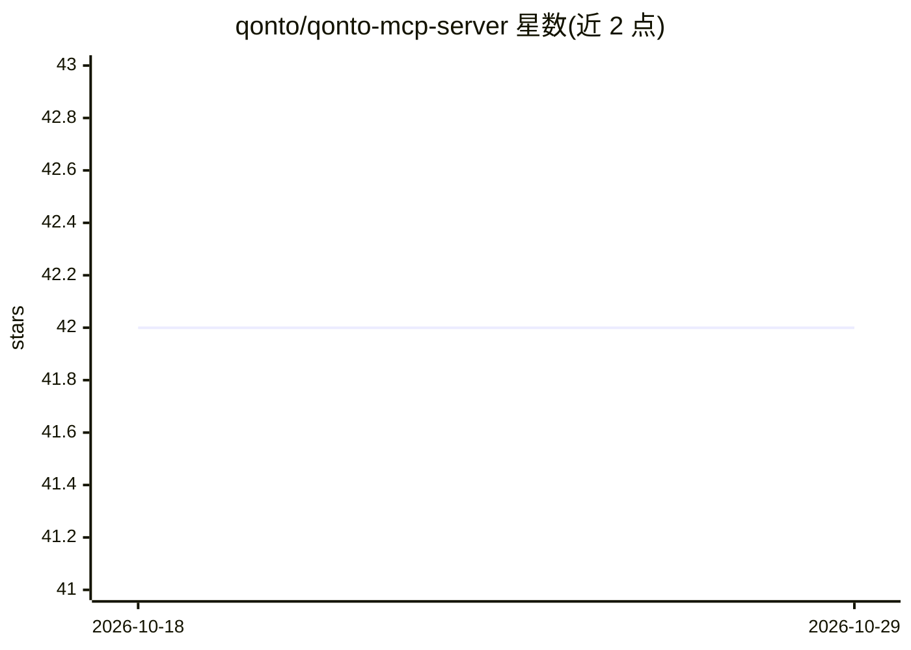

# qonto/qonto-mcp-server

⭐ 42 · Python · MIT · 推送 2026-06-22 · [GitHub](https://github.com/qonto/qonto-mcp-server) · [官网](https://qonto.com) · 组织维护

**Qonto 银行账户的本地 MCP 服务器（已停止维护）**

Python 实现的本地 MCP 服务器，通过 Qonto 第三方 API 向 AI 模型提供组织信息、账户余额、交易历史等工具。需配置 QONTO_API_KEY 与组织 ID，支持 stdio 与 streamable-http 传输，可经 Docker 镜像或源码（uv）运行并接入 Claude Desktop。README 顶部声明 Qonto 已推出官方托管的 MCP 服务器（OAuth、支持读写），本仓库不再积极维护，建议改用官方版本。

## 筛选速览

| 维度 | 判定 | 备注 |
|---|---|---|
| AI 角色 | `ai-ecosystem` | LLM/agent 周边工具 |
| 许可风险 | `permissive` | MIT |
| 部署形态 | `self-host` | docker 或自建部署 |
| 模型依赖 | — | README 未给出锁定关系 |
| 硬件要求 | — | 无带数字的原话,不猜 |
| 安装摩擦 | `low` | 无编译、无系统依赖或容器化 |
| 成熟度 | — | 结构信号不足 |

## 能力要点

- 提供组织信息、账户余额、交易历史等 MCP 工具
- 支持 Docker 镜像与本地源码两种运行方式
- 支持 stdio 与 streamable-http 两种传输协议

## 适用场景

- 让 Claude Desktop 等客户端查询我的 Qonto 账户与交易数据
- 本地运行以控制银行 API 凭据的暴露范围

## 场景标签

 · 领域:金融/API 集成

## 证据(README 行号)

> L27: The MCP (Model Context Provider) protocol gives AI models access to additional functionality like reading files, ac
> L96: This MCP server provides the following tools for interacting with your Qonto account:

## 星数曲线

2026-10-18 42 → 2026-10-29 42（+0）

---
*卡片 v1 · prompt 1.4 · 生成 2026-10-25 · 置信度 high · 依据 README sha `ec226291dbb2` · [字段定义](../../DATASET.md)*
