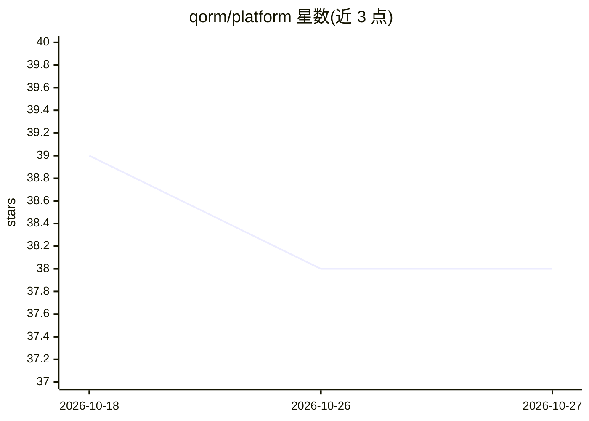

# qorm/platform

⭐ 38 · Go · MIT · 推送 2026-08-21 · [GitHub](https://github.com/qorm/platform) · [官网](https://qorm.com) · 组织维护 · 中文 README

**面向 AI agent 的声明式 JSON UI 跨平台应用运行时**

用 Go 编写的 agent 原生跨平台应用平台：将 UI 描述为语言中立的 JSON（manifest + scenes + actions），由 AI 助手（Claude、Cursor 等）通过 MCP 协议的 25 个工具对运行中的应用进行脚手架搭建、编辑（带 previewToken 审查门控）、运行与几何级设计验证（qorm measure/check），人与 AI 通过 SSE 共享同一实时运行时。构建产物为 ed25519 签名的单一约 7MB 静态二进制，支持 Web/iOS/Android/macOS/Linux/Windows/小程序；Go 仅为构建时依赖，下载的二进制可独立运行，原生桌面窗口需按平台用 cgo 构建。

## 筛选速览

| 维度 | 判定 | 备注 |
|---|---|---|
| AI 角色 | `ai-ecosystem` | LLM/agent 周边工具 |
| 许可风险 | `permissive` | MIT |
| 部署形态 | `library` | 以包/库形式分发 |
| 模型依赖 | — | README 未给出锁定关系 |
| 硬件要求 | — | 无带数字的原话,不猜 |
| 安装摩擦 | `medium` | 含编译或系统依赖之一 |
| 成熟度 | — | 结构信号不足 |

## 能力要点

- MCP 暴露 25 个工具：inspect/dispatch/assert/preview_patch→apply_patch/simulate
- 人与 AI 共享同一实时运行时（SSE /events 推送，双向可见）
- ed25519 签名的内容寻址 bundle，含 OTA 与回滚
- qorm measure/check 按渲染几何定量验证 AI 的 UI 修改

## 适用场景

- 让 Claude/Cursor 等 agent 直接搭建并迭代我的应用 UI
- 人与 AI 在同一个运行中的应用上实时协作编辑
- 一份 JSON 应用打包发布到 Web/iOS/Android/桌面/小程序

## 场景标签

 · 领域:跨平台 UI 框架/Agent 开发工具

## 证据(README 行号)

> L7: **Build apps with your AI assistant — together, live.** QORM
> L9: describe an app as standardized, language-neutral JSON, and your AI (Claude, Cursor, …) can **scaffold, edit, run, a
> L91: - **Agent-native MCP**: 25 tools to read, edit (review-gated), run and self-verify a
> L92:  live app. Seamlessly integrates with Claude, Cursor, Windsurf, or any MCP-compatible agent.

## 星数曲线

2026-10-18 39 → 2026-10-27 38（-1）

---
*卡片 v1 · prompt 1.4 · 生成 2026-10-25 · 置信度 high · 依据 README sha `0ef75f96e91e` · [字段定义](../../DATASET.md)*
