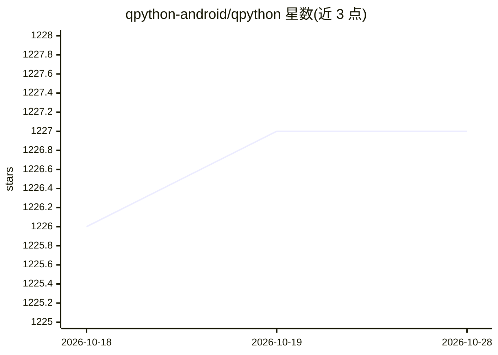

# qpython-android/qpython

⭐ 1,227 · Java · 推送 2026-04-14 · [GitHub](https://github.com/qpython-android/qpython) · [官网](https://www.qpython.org) · 组织维护 · 中文 README

**Android 上的 Python 引擎与 IDE，面向 Python 与 AI 学习者**

在 Android 设备上提供 Python 解释器、运行时环境、编辑器、QPYI 与集成 SL4A，定位是让 Python 驱动 Android 设备（相机、传感器、短信、媒体等 API），项目自述面向 Python 和 AI 学习者。分为两个分支：本仓库的 QPython Ox 面向初学者提供友好功能，QPython 3x 面向有经验用户提供高级技术特性。源码构建需 macOS + Android Studio，通过 git clone 与 submodule 初始化后编译。

## 筛选速览

| 维度 | 判定 | 备注 |
|---|---|---|
| AI 角色 | `ai-enhanced` | 去掉 AI 部分产品仍成立 |
| 许可风险 | `none` | — |
| 部署形态 | `None` |  |
| 模型依赖 | — | README 未给出锁定关系 |
| 硬件要求 | — | 无带数字的原话,不猜 |
| 安装摩擦 | `low` | 无编译、无系统依赖或容器化 |
| 成熟度 | — | 结构信号不足 |

## 能力要点

- Android 上的 Python 解释器、运行时与编辑器
- 集成 SL4A，可调用 Android 相机/传感器/短信/媒体 API
- 两个分支：Ox 面向初学者，3x 面向有经验用户

## 适用场景

- 在 Android 手机上直接编写和运行 Python 脚本
- 用 Python 调用手机传感器、相机等设备功能进行学习实验
- 在移动端做 Python 编程练习

## 场景标签

 · 领域:移动开发/编程工具

## 证据(README 行号)

> L5: QPython is the Python engine for android. It contains some amazing features such as Python interpreter, runtime envi
> L7: Compared with other Python apps, QPython mainly solves how to use Python to drive your Android device work. Good SL4

## 星数曲线

2026-10-18 1,226 → 2026-10-28 1,227（+1）

---
*卡片 v1 · prompt 1.4 · 生成 2026-10-21 · 置信度 mid · 依据 README sha `0daeff4ce2f1` · [字段定义](../../DATASET.md)*
