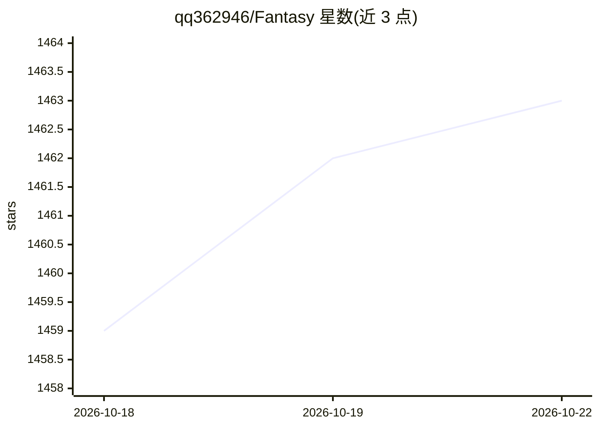

# qq362946/Fantasy

⭐ 1,463 · C# · NOASSERTION · 推送 2026-10-19 · [GitHub](https://github.com/qq362946/Fantasy) · [官网](https://github.com/qq362946/Fantasy) · 组织维护 · 中文 README

**零反射 C# 游戏服务器框架，附 AI Agent 编码技能**

面向大型多人在线游戏及非游戏业务的 C# 服务器框架，采用 ECS 设计、零反射架构并支持 Native AOT；提供 TCP/KCP/WebSocket/HTTP 多协议、内置 Control Center 与服务发现、Roaming 路由和跨服通信，支持 .NET 8.0+ 与 Unity 2022.3.62+ 客户端接入。AI 部分为 fantasy-net Skill，可配合 Claude、Codex 等 Agent 学习框架、生成 Entity/协议/配置代码并审查代码规范。通过 dotnet tool 安装的 Fantasy CLI 脚手架创建和管理项目；MongoDB 为可选依赖。

## 筛选速览

| 维度 | 判定 | 备注 |
|---|---|---|
| AI 角色 | `ai-enhanced` | 去掉 AI 部分产品仍成立 |
| 许可风险 | `none` | NOASSERTION |
| 部署形态 | `None` |  |
| 模型依赖 | — | README 未给出锁定关系 |
| 硬件要求 | — | 无带数字的原话,不猜 |
| 安装摩擦 | `medium` | 含编译或系统依赖之一 |
| 成熟度 | — | 结构信号不足 |

## 能力要点

- 零反射架构与 Native AOT 支持
- TCP/KCP/WebSocket/HTTP 多协议，一套代码切换
- 内置 Control Center、服务发现与 Roaming 路由
- fantasy-net Skill 配合 Claude/Codex 等 AI Agent 生成与审查框架代码

## 适用场景

- 开发 MMORPG、实时对战或卡牌类游戏服务端
- 用自然语言让 AI Agent 生成 Entity/协议/配置等框架代码
- 跨服通信与服务动态扩缩容场景搭建
- 非游戏业务的分布式网络服务开发

## 场景标签

 · 领域:游戏服务器框架/网络开发

## 证据(README 行号)

> L15: Fantasy 是一个**零反射、高性能的 C# 游戏服务器框架**，专为大型多人在线游戏打造。
> L24: Fantasy 已提供专用 `fantasy-net` Skill，可配合 Claude、Codex、OpenCode、OpenClaw 等 AI Agent 使用。

## 星数曲线

2026-10-18 1,459 → 2026-10-22 1,463（+4）

---
*卡片 v1 · prompt 1.4 · 生成 2026-10-21 · 置信度 high · 依据 README sha `1d1873beaf78` · [字段定义](../../DATASET.md)*
