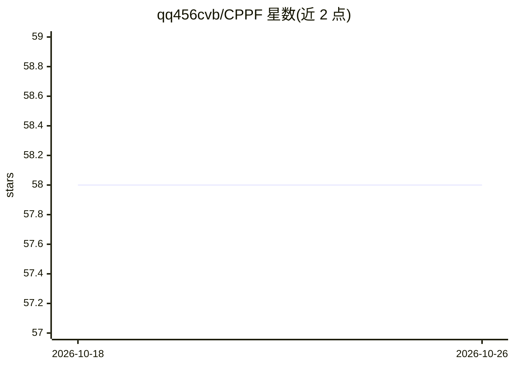

# qq456cvb/CPPF

⭐ 58 · Jupyter Notebook · MIT · 推送 2026-10-05 · [GitHub](https://github.com/qq456cvb/CPPF) · [官网](https://qq456cvb.github.io/projects/cppf) · 个人维护

**类别级 9D 位姿估计研究代码：sim-to-real 投票式姿态预测**

CVPR 2022 论文 CPPF 的官方 PyTorch 实现，提供训练与测试代码。方法仅在 ShapeNet 合成模型上训练，使用局部 SE3 不变几何特征与自底向上投票方案，可直接应用于 NOCS REAL275、SUN RGB-D 等真实场景的类别级 9D 位姿估计，支持实例分割或包围盒掩码输入，也支持自定义物体集合训练与零样本推理。安装依赖 Conda、PyTorch、MinkowskiEngine（需 g++-7 编译），预训练模型托管于 Hugging Face。

## 筛选速览

| 维度 | 判定 | 备注 |
|---|---|---|
| AI 角色 | `ai-native` | 本体是模型或模型工具 |
| 许可风险 | `permissive` | MIT |
| 部署形态 | `desktop` | 安装包/桌面程序 |
| 模型依赖 | — | README 未给出锁定关系 |
| 硬件要求 | — | 无带数字的原话,不猜 |
| 安装摩擦 | `low` | 无编译、无系统依赖或容器化 |
| 成熟度 | — | 结构信号不足 |

## 能力要点

- 纯 sim-to-real：仅用 ShapeNet 合成数据训练即可用于真实场景
- 局部 SE3 不变特征 + 自底向上投票方案
- 支持实例分割掩码与包围盒掩码两种输入，含零样本推理 notebook
- 提供 NOCS REAL275 / SUN RGB-D / 自定义物体三类训练测试流程

## 适用场景

- 在 NOCS REAL275 或 SUN RGB-D 上复现类别级位姿估计结果
- 用自定义 3D 物体集合训练位姿估计模型
- 仅有包围盒掩码时获得类别级 9D 位姿预测

## 场景标签

 · 领域:计算机视觉/3D 位姿估计

## 证据(README 行号)

> L19:  CPPF is a pure sim-to-real method that achieves 9D pose estimation in the wild. Our model is trained solely on Sha
> L33: This is the official code implementation of CPPF, including both training and testing. Inference on custom datasets

## 星数曲线

2026-10-18 58 → 2026-10-26 58（+0）

---
*卡片 v1 · prompt 1.4 · 生成 2026-10-24 · 置信度 mid · 依据 README sha `cea9ba090727` · [字段定义](../../DATASET.md)*
