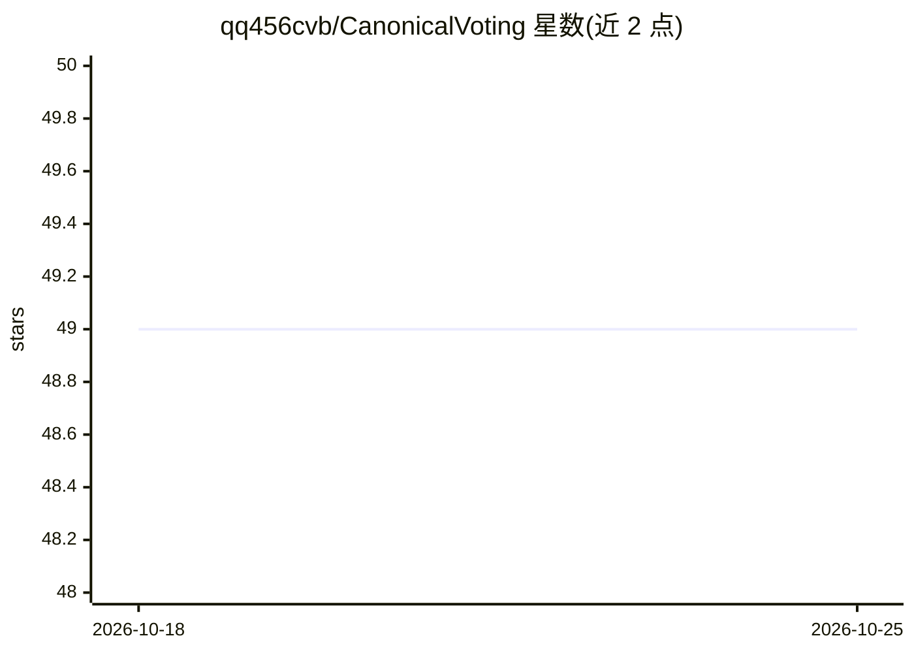

# qq456cvb/CanonicalVoting

⭐ 49 · Python · 推送 2026-10-05 · [GitHub](https://github.com/qq456cvb/CanonicalVoting) · [官网](https://qq456cvb.github.io/projects/canonical-voting) · 组织维护

**CVPR2022 论文官方实现：3D 点云带朝向包围框检测**

Canonical Voting（CVPR 2022）的官方 PyTorch 实现。方法将 Hough 投票目标解耦为局部规范坐标（LCC）、框尺度与框朝向：逐点回归 LCC 与尺度，朝向由规范投票机制生成，再用 LCC 感知的反向投影检查算法从投票图中迭代切割包围框并剔除误检。面向 3D 视觉科研人员，支持在 ScanNet 与 SUN RGB-D 上训练和评测 mAP，提供预训练模型下载。依赖 MinkowskiEngine 与自编译的 Hough Voting CUDA 模块。

## 筛选速览

| 维度 | 判定 | 备注 |
|---|---|---|
| AI 角色 | `ai-native` | 本体是模型或模型工具 |
| 许可风险 | `none` | — |
| 部署形态 | `library` | 以包/库形式分发 |
| 模型依赖 | — | README 未给出锁定关系 |
| 硬件要求 | — | 无带数字的原话,不猜 |
| 安装摩擦 | `medium` | 含编译或系统依赖之一 |
| 成熟度 | — | 结构信号不足 |

## 能力要点

- LCC/尺度回归 + 规范投票生成框朝向的检测方法
- LCC 感知反向投影检查迭代切割包围框并消除误检
- 支持 ScanNet / SceneNN / SUN RGB-D 数据集的训练与 mAP 评测
- 提供联合训练与按类别分开训练两种模式及预训练模型

## 适用场景

- 在 ScanNet 或 SUN RGB-D 上复现论文的 3D 检测结果
- 基于带朝向包围框检测做 3D 场景理解研究
- 使用预训练模型直接评测 mAP 指标

## 场景标签

`目标检测` `科研工具` · 领域:学习与行业

## 证据(README 行号)

> L22: Canonical Voting is a 3D detection method that disentangles Hough voting targets into Local Canonical Coordinates (
> L32: This is the official Pytorch implementation of our work: Canonical Voting.

## 星数曲线

2026-10-18 49 → 2026-10-25 49（+0）

---
*卡片 v1 · prompt 1.4 · 生成 2026-10-24 · 置信度 mid · 依据 README sha `a7684e07254c` · [字段定义](../../DATASET.md)*
