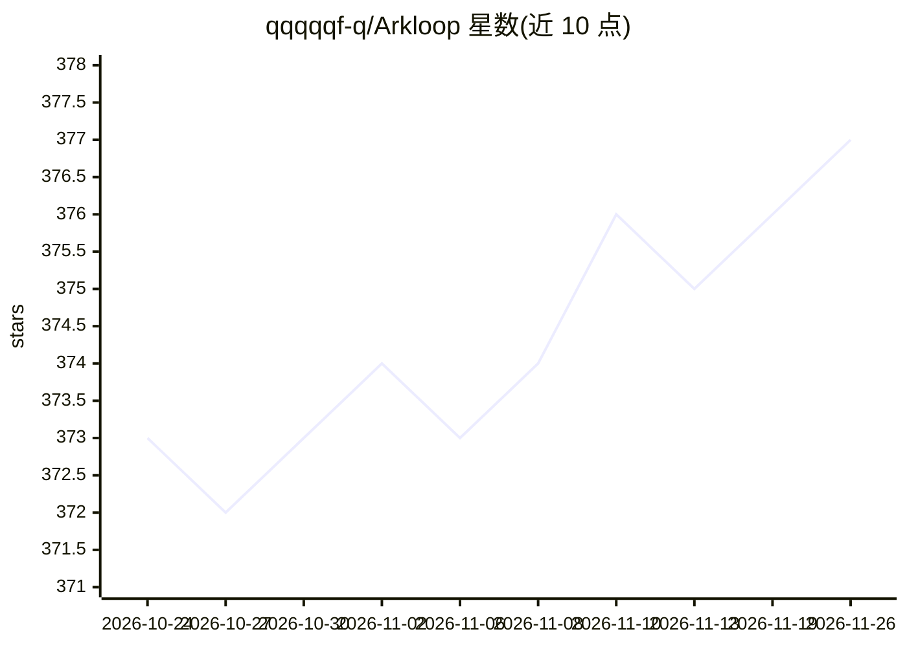

# qqqqqf-q/Arkloop

⭐ 377 · Go · NOASSERTION · 推送 2026-11-21 · [GitHub](https://github.com/qqqqqf-q/Arkloop) · [官网](https://arkloop.io) · 个人维护 · 中文 README

**本地优先的个人 AI Agent 桌面平台，开箱即用**

本地优先的对话式 AI Agent 平台：Electron 桌面应用内嵌单一 Go 进程后端，存储为本地 SQLite，无需部署服务器或维护基础设施。功能包括多模型路由（用户自备 key，OpenAI/Anthropic/Gemini 及 OpenAI 兼容 API）、内置工具与 MCP 服务器、子 Agent 与定时任务、可选语义记忆，以及 Telegram/Discord/QQ/飞书/微信 渠道机器人共用同一 Agent 管线。提供 macOS/Linux/Windows 安装包，CLI 可经 Homebrew、AUR 或脚本安装。许可证为修改版 Apache 2.0，含附加条件。

## 筛选速览

| 维度 | 判定 | 备注 |
|---|---|---|
| AI 角色 | `ai-native` | 本体是模型或模型工具 |
| 许可风险 | `none` | NOASSERTION |
| 部署形态 | `library` | 以包/库形式分发 |
| 模型依赖 | — | README 未给出锁定关系 |
| 硬件要求 | — | 无带数字的原话,不猜 |
| 安装摩擦 | `low` | 无编译、无系统依赖或容器化 |
| 成熟度 | — | 结构信号不足 |

## 能力要点

- 多模型路由：OpenAI、Anthropic、Gemini 及任何 OpenAI 兼容 API，按优先级路由
- Agent 运行时：内置工具、MCP 服务器、ClawHub 技能，支持子 Agent 与定时任务
- 渠道机器人：Telegram/Discord/QQ/飞书/微信 共用同一 Agent 管线
- 单 Go 进程 + SQLite 架构，无 Postgres/Redis/消息队列依赖

## 适用场景

- 在本地桌面运行个人 AI Agent 并接入 IM 渠道对话
- 用自有 API key 做多模型优先级路由
- 通过定时任务与子 Agent 运行自动化工作流

## 场景标签

`聊天机器人` `AI 助手` · 领域:对话与助手

## 证据(README 行号)

> L14: Arkloop is a personal open-source project: a local-first platform for conversational AI agents. Multi-model routing
> L55: - **Multi-Model Routing** — OpenAI, Anthropic, Gemini, and any OpenAI-compatible API; priority-based routing with y
> L56: - **Agent Runtime** — Built-in tools, MCP servers, and ClawHub skills; sub-agent spawning and scheduled jobs

## 星数曲线

2026-10-24 373 → 2026-11-26 377（+4）

---
*卡片 v1 · prompt 1.4 · 生成 2026-11-25 · 置信度 mid · 依据 README sha `9f1ddddddaa7` · [字段定义](../../DATASET.md)*
