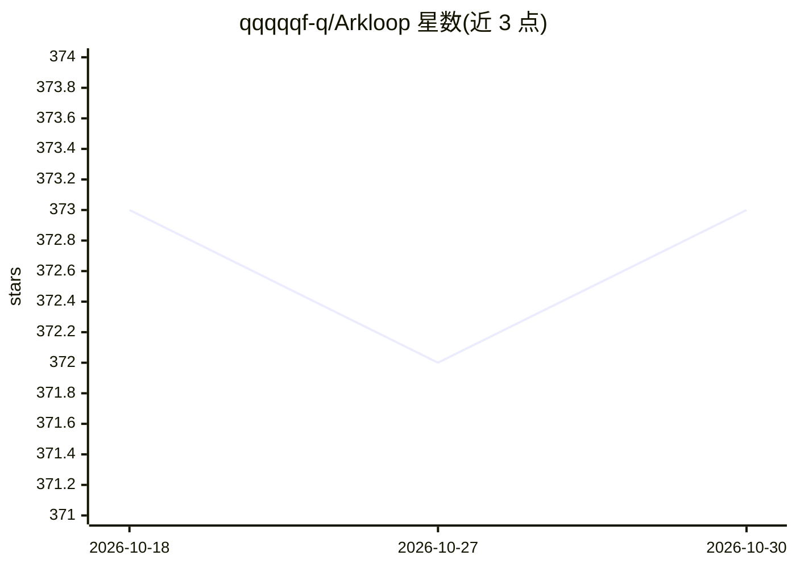

# qqqqqf-q/Arkloop

⭐ 373 · Go · NOASSERTION · 推送 2026-10-13 · [GitHub](https://github.com/qqqqqf-q/Arkloop) · [官网](https://arkloop.io) · 个人维护 · 中文 README

**本地优先的对话式 AI Agent 桌面平台**

个人开源项目，提供 local-first 的对话式 AI Agent 平台：Electron 桌面应用内嵌单个 Go 进程作为全部后端，配 SQLite 存储，无需部署服务器。功能含多模型路由（OpenAI/Anthropic/Gemini 及 OpenAI 兼容 API，自带 key）、Agent 运行时（内置工具、MCP、ClawHub 技能、子 Agent 与定时任务）、纯文本/可选语义记忆、Telegram/Discord/QQ/飞书/微信渠道接入与自定义人格。支持 GitHub Releases 下载安装包、Homebrew/AUR 安装 CLI，限 Arkloop License（修改版 Apache 2.0，附条件）。

## 筛选速览

| 维度 | 判定 | 备注 |
|---|---|---|
| AI 角色 | `ai-native` | 本体是模型或模型工具 |
| 许可风险 | `none` | NOASSERTION |
| 部署形态 | `library` | 以包/库形式分发 |
| 模型依赖 | — | README 未给出锁定关系 |
| 硬件要求 | — | 无带数字的原话,不猜 |
| 安装摩擦 | `low` | 无编译、无系统依赖或容器化 |
| 成熟度 | — | 结构信号不足 |

## 能力要点

- 单进程 Go 后端 + SQLite，本地运行零部署
- 多模型优先级路由，OpenAI 兼容 API 通用接入
- MCP servers、ClawHub 技能与子 Agent 调度
- Telegram/Discord/QQ/飞书/微信多渠道共享同一 Agent 管线

## 适用场景

- 桌面开箱即用的多模型 AI 聊天与 Agent 工具调用
- 通过 Telegram/QQ 等机器人渠道复用同一 Agent
- 无头 Linux 服务器上用 ark web 运行本地实例

## 场景标签

`聊天机器人` `AI 助手` · 领域:对话与助手

## 证据(README 行号)

> L14: Arkloop is a personal open-source project: a local-first platform for conversational AI agents. Multi-model routing
> L55: - **Multi-Model Routing** — OpenAI, Anthropic, Gemini, and any OpenAI-compatible API; priority-based routing with y
> L58: - **Channels** — Telegram, Discord, QQ, Feishu, and WeChat bots sharing the same agent pipeline, with scheduled hea

## 星数曲线

2026-10-18 373 → 2026-10-30 373（+0）

---
*卡片 v1 · prompt 1.4 · 生成 2026-10-21 · 置信度 mid · 依据 README sha `3fee7a16d731` · [字段定义](../../DATASET.md)*
