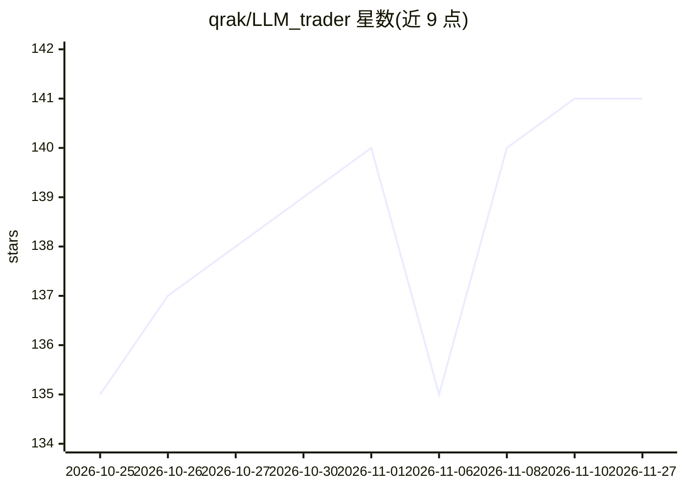

# qrak/LLM_trader

⭐ 141 · Python · MIT · 推送 2026-11-26 · [GitHub](https://github.com/qrak/LLM_trader) · [官网](https://semanticsignal.qrak.org) · 个人维护 · 中文 README

**LLM 纸面交易 agent：读取市场文本并保留交易记忆**

名为 Semantic Signal 的实验性 LLM 交易 agent，仅做 paper trading，不涉及真实资金。每根 K 线收盘后将指标数值、价格动作与自身已平仓交易记忆发送给文本模型，再由确定性规则校验后才记账纸面交易。交易记忆存于 ChromaDB（bge-base-en-v1.5 嵌入），仪表盘展示 prompt 预览、决策与记忆视图，公开账本记录每笔平仓交易及与买入持有对比。Python 3.13 专用，需一个 API key 或兼容 OpenAI/Anthropic 的本地服务器。

## 筛选速览

| 维度 | 判定 | 备注 |
|---|---|---|
| AI 角色 | `ai-native` | 本体是模型或模型工具 |
| 许可风险 | `permissive` | MIT |
| 部署形态 | `library` | 以包/库形式分发 |
| 模型依赖 | — | README 未给出锁定关系 |
| 硬件要求 | — | 无带数字的原话,不猜 |
| 安装摩擦 | `low` | 无编译、无系统依赖或容器化 |
| 成熟度 | `idea` | |

## 能力要点

- ChromaDB 交易记忆：每次 prompt 携带最近 3 笔历史交易与匹配规则
- 确定性规则校验模型输出（ADX 对比趋势声明、EV 规则由自身平仓数据计算）
- 公开账本与冻结快照 + 复现脚本
- 只读 MCP 服务器开放账本查询

## 适用场景

- 观察 LLM 交易 agent 的纸面交易公开记录
- 研究带交易记忆的 agent 决策机制
- 在 CCXT 支持的市场上运行模拟交易实验

## 场景标签

`金融量化` · 领域:学习与行业

## 证据(README 行号)

> L13: **Semantic Signal** is an experimental LLM trading agent that runs on paper. Once per closed candle it
> L14: sends the numeric indicator stack, the price action and its own closed-trade memory to a text model,
> L15: then checks the answer with deterministic rules before a paper trade is booked. The dashboard shows a prompt previe

## 星数曲线

2026-10-25 135 → 2026-11-27 141（+6）

---
*卡片 v1 · prompt 1.4 · 生成 2026-11-27 · 置信度 high · 依据 README sha `a8fdeb358976` · [字段定义](../../DATASET.md)*
