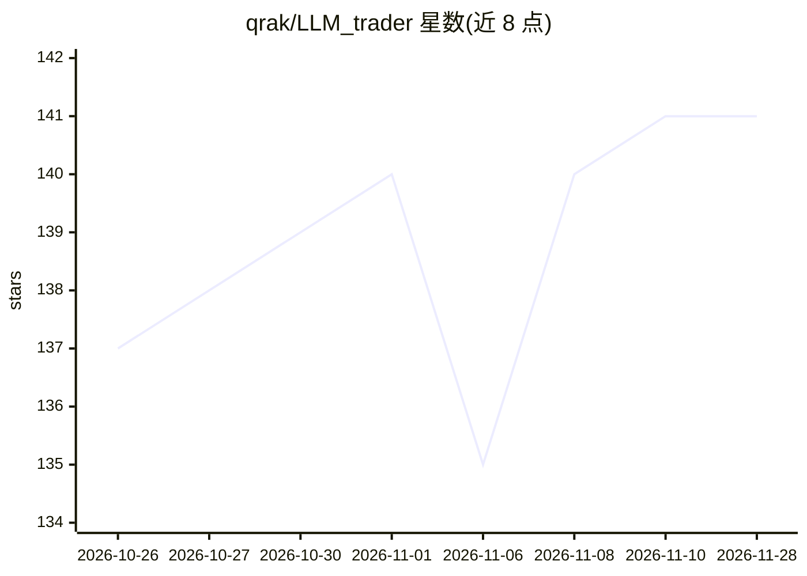

# qrak/LLM_trader

⭐ 141 · Python · MIT · 推送 2026-11-27 · [GitHub](https://github.com/qrak/LLM_trader) · [官网](https://semanticsignal.qrak.org) · 个人维护 · 中文 README

**LLM 交易 agent：读市场文本、留交易记忆、公开账本**

实验性加密货币交易 agent：每根 K 线收盘后将市场指标、新闻与已平仓交易记忆发送给文本模型，生成决策后用确定性风控规则校验。默认仅模拟盘（paper trading），公开账本记录每笔亏损；图表仅用于仪表盘与 Discord，不作为模型输入；订单转发需另行接入独立执行器。要求 Python 3.13，约 3 GB 磁盘，支持任意 OpenAI/Anthropic 兼容本地服务器。README 自述 67 天模拟结果不构成优势证据。

## 筛选速览

| 维度 | 判定 | 备注 |
|---|---|---|
| AI 角色 | `ai-native` | 本体是模型或模型工具 |
| 许可风险 | `permissive` | MIT |
| 部署形态 | `library` | 以包/库形式分发 |
| 模型依赖 | — | README 未给出锁定关系 |
| 硬件要求 | — | 无带数字的原话,不猜 |
| 安装摩擦 | `low` | 无编译、无系统依赖或容器化 |
| 成熟度 | — | 结构信号不足 |

## 能力要点

- 模型决策由确定性风控规则二次校验
- 已平仓交易记忆随提示词送入模型
- 公开账本与冻结快照结果可由脚本复现
- 支持 OpenAI/Anthropic 兼容本地服务器，无需 API key

## 适用场景

- BTC/USDC 4h 周期的模拟盘策略实验
- 研究提示词、记忆检索如何影响交易决策
- 在接入执行器前以纸面交易验证流程

## 场景标签

`金融量化` `Agent 记忆` · 领域:Agent 开发

## 证据(README 行号)

> L13: **Semantic Signal** is an experimental trading agent. On each closed candle it sends market indicators, news and cl
> L1: # Semantic Signal — an LLM trading agent that reads the market as text and keeps memory of its closed trades

## 星数曲线

2026-10-26 137 → 2026-11-28 141（+4）

---
*卡片 v1 · prompt 1.4 · 生成 2026-11-28 · 置信度 high · 依据 README sha `6cec3e36db56` · [字段定义](../../DATASET.md)*
