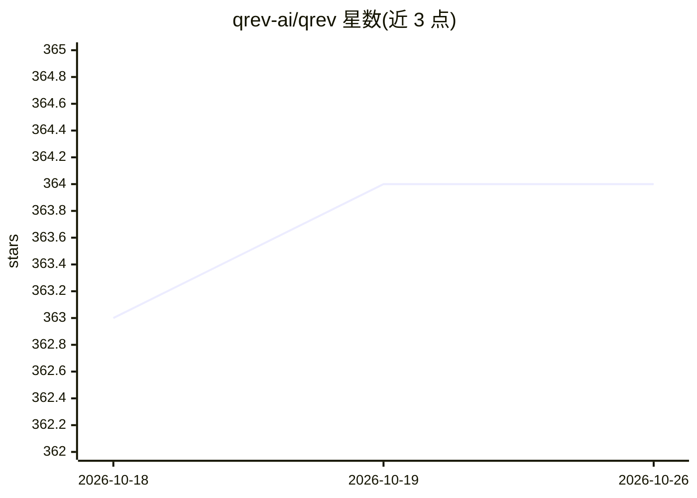

# qrev-ai/qrev

⭐ 364 · JavaScript · AGPL-3.0 · 推送 2026-02-07 · [GitHub](https://github.com/qrev-ai/qrev) · [官网](https://qrev.ai) · 组织维护

**开源 AI 优先的 Salesforce 替代品：AI Agent 驱动销售组织**

面向销售组织的开源 CRM 系统，定位为 Salesforce 的替代品。核心设计是以名为 Qai 的超级代理为基础，根据用户角色和权限执行不同任务，内部由多个数字员工/代理协作。技术栈为 TypeScript/Node.js 前后端、MongoDB 主库、ChromaDB 向量库、Langchain LLM 工具。由三个组件构成：Client App、App Server、AI Server，用户可上传 People CSV 生成营销活动。README 自述处于早期开发阶段，支持若干第三方集成（详见 Server README）。

## 筛选速览

| 维度 | 判定 | 备注 |
|---|---|---|
| AI 角色 | `ai-native` | 本体是模型或模型工具 |
| 许可风险 | `viral` | AGPL-3.0 |
| 部署形态 | `library` | 以包/库形式分发 |
| 模型依赖 | — | README 未给出锁定关系 |
| 硬件要求 | — | 无带数字的原话,不猜 |
| 安装摩擦 | `low` | 无编译、无系统依赖或容器化 |
| 成熟度 | `idea` | |

## 能力要点

- 以超级代理 Qai 为基础，按角色与权限执行不同任务
- 上传 People CSV 由 QAI bot 生成营销活动
- TypeScript/Node.js + MongoDB + ChromaDB + Langchain 技术栈
- Client / App Server / AI Server 三组件架构

## 适用场景

- 销售团队用 AI Agent 自动化 SDR/BDR 等销售职能
- 作为 Salesforce 的可自托管开源替代
- 基于客户 CSV 数据生成营销活动

## 场景标签

`多智能体` · 领域:Agent 开发

## 证据(README 行号)

> L3:  🤖 AI Agents to scale your Sales org infinitely; Open Source alternative to Salesforce 🤖
> L20: If Salesforce were built today, starting with AI, it would be built with AI Agents at the foundation.
> L33: We are starting with the latter approach. We think based on the users role and role based permissions, Qai will be 

## 星数曲线

2026-10-18 363 → 2026-10-26 364（+1）

---
*卡片 v1 · prompt 1.4 · 生成 2026-10-21 · 置信度 high · 依据 README sha `2591e6ff2e3e` · [字段定义](../../DATASET.md)*
