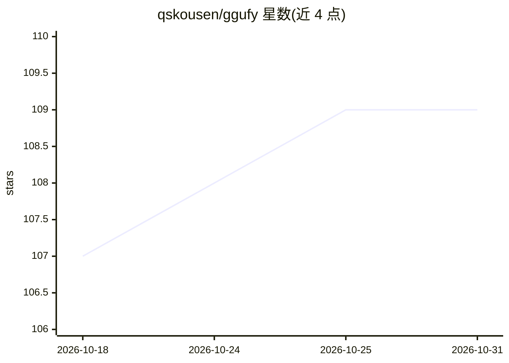

# qskousen/ggufy

⭐ 109 · Zig · MIT · 推送 2026-10-24 · [GitHub](https://github.com/qskousen/ggufy) · 个人维护

**Zig 编写的 safetensors/GGUF 模型格式与量化转换工具（CLI/GUI）**

单文件可执行程序，含 CLI 与 GUI 两种形态，运行于 Linux/Windows/macOS（arm64 与 x86_64）。主要用途是把 safetensors 模型转换为 GGUF 格式并执行量化，也支持 safetensors 到 safetensors 的转换（如 BF16 到 INT8_CONVROT），量化部分调用 ggml 的 C/C++ 代码。当前面向图像与视频扩散模型（SD1.5、SDXL、Flux、MiniMax H3 等 20 余种架构）及少量 LLM，支持基于敏感度文件的感知量化。releases 页提供预编译产物，也可用 zig 0.17.0 源码构建或经 Docker 运行。

## 筛选速览

| 维度 | 判定 | 备注 |
|---|---|---|
| AI 角色 | `ai-ecosystem` | LLM/agent 周边工具 |
| 许可风险 | `permissive` | MIT |
| 部署形态 | `desktop` | 安装包/桌面程序 |
| 模型依赖 | — | README 未给出锁定关系 |
| 硬件要求 | — | 无带数字的原话,不猜 |
| 安装摩擦 | `low` | 无编译、无系统依赖或容器化 |
| 成熟度 | — | 结构信号不足 |

## 能力要点

- safetensors ⇄ GGUF 转换，覆盖 30 余种输入/输出数据类型
- 支持 20 余种图像/视频扩散模型架构的转换
- 基于敏感度文件的感知量化（部分架构内置敏感度数据）
- 单文件可执行，CLI 与 GUI 两种形态，支持 Docker 运行

## 适用场景

- 把 SD/SDXL/Flux 等扩散模型从 safetensors 转为 GGUF 量化格式
- 对模型做 q4_k 等量化以缩减体积
- 通过 GUI 界面完成转换操作

## 场景标签

`模型量化` · 领域:训练与推理

## 证据(README 行号)

> L8: - supports converting safetensors and gguf quantizations
> L127: The primary use case for ggufy is converting models from safetensors to gguf format:
> L130: ggufy convert model.safetensors -d q4_k

## 星数曲线

2026-10-18 107 → 2026-10-31 109（+2）

---
*卡片 v1 · prompt 1.4 · 生成 2026-10-23 · 置信度 high · 依据 README sha `f12f46a163f4` · [字段定义](../../DATASET.md)*
