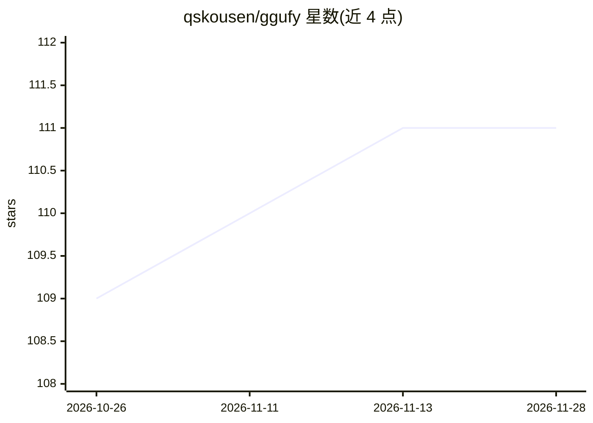

# qskousen/ggufy

⭐ 111 · Zig · MIT · 推送 2026-11-25 · [GitHub](https://github.com/qskousen/ggufy) · 个人维护

**为扩散模型与 LLM 提供安全张量/GGUF 格式转换的 CLI/GUI 工具**

Zig 编写的单文件可执行格式转换工具，提供 CLI 与 GUI 两种形态，覆盖 Linux/Windows/macOS（arm64/x86_64）。支持 safetensors 与 gguf 互转及多种量化类型，可生成量化敏感度文件做敏感度感知量化；主要面向图像/视频扩散模型（SD1.5、SDXL、Flux 等），也支持有限的 LLM 子集。安装方式为下载预编译可执行文件，或用 zig 源码构建，也可经 Docker 运行。

## 筛选速览

| 维度 | 判定 | 备注 |
|---|---|---|
| AI 角色 | `ai-ecosystem` | LLM/agent 周边工具 |
| 许可风险 | `permissive` | MIT |
| 部署形态 | `desktop` | 安装包/桌面程序 |
| 模型依赖 | — | README 未给出锁定关系 |
| 硬件要求 | — | 无带数字的原话,不猜 |
| 安装摩擦 | `low` | 无编译、无系统依赖或容器化 |
| 成熟度 | — | 结构信号不足 |

## 能力要点

- 单文件可执行，CLI 与 GUI 两种形态，跨三大平台
- 支持 safetensors 与 gguf 多种量化类型的读/写
- 支持敏感度感知量化（部分架构内置敏感度数据）
- 提供 Docker 构建与运行流程

## 适用场景

- 把下载的 safetensors 扩散模型转成 GGUF 量化格式以减小体积
- 为 ComfyUI 工作流准备量化后的模型文件
- 检查模型文件的量化类型与文件头信息

## 场景标签

`模型量化` · 领域:训练与推理

## 证据(README 行号)

> L2: A lightweight and efficient tool to convert tensor formats.
> L8: - supports converting safetensors and gguf quantizations
> L11: - currently targets image and video diffusion models (SD1.5, SDXL, MiniMax H3, etc.) as well as a limited subset of

## 星数曲线

2026-10-26 109 → 2026-11-28 111（+2）

---
*卡片 v1 · prompt 1.4 · 生成 2026-11-28 · 置信度 high · 依据 README sha `a1f8c8a6e5c0` · [字段定义](../../DATASET.md)*
