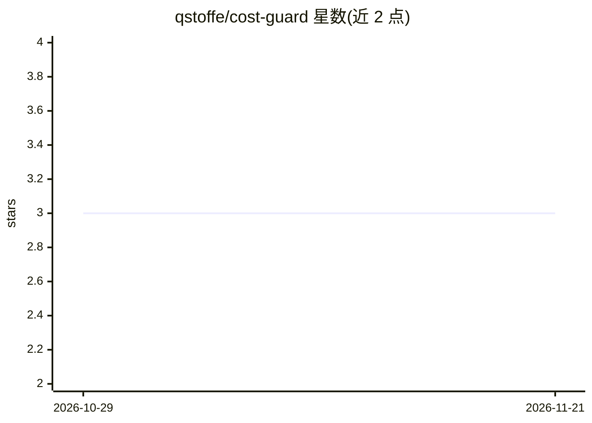

# qstoffe/cost-guard

⭐ — · [GitHub]() · 个人维护

**为 OpenCode 用户提供本地的用量、成本与配额监控面板**

Cost Guard 是一个面向 OpenCode 的本地 Web 仪表盘：运行本地 Web 服务器并在浏览器中打开界面，实时查看 prompts 与会话，查阅模型成本、Token Mix、上下文与账户配额信息。要求本机装有 Python 3.11+ 与 OpenCode，支持 Windows 和 macOS；Windows 通过 .cmd 脚本启动，macOS 通过 .command 脚本启动，托盘/菜单提供退出操作，另保留终端报告与 Watch 的旧式启动方式。

## 筛选速览

| 维度 | 判定 | 备注 |
|---|---|---|
| AI 角色 | `ai-ecosystem` | LLM/agent 周边工具 |
| 许可风险 | `none` | — |
| 部署形态 | `None` |  |
| 模型依赖 | — | README 未给出锁定关系 |
| 硬件要求 | — | 无带数字的原话,不猜 |
| 安装摩擦 | `low` | 无编译、无系统依赖或容器化 |
| 成熟度 | — | 结构信号不足 |

## 能力要点

- 本地 Web 仪表盘，浏览器访问，无需云端部署
- 实时展示 prompts 与会话，参考模型成本与 Token Mix
- 显示上下文与账户配额信息
- 提供 Windows .cmd 与 macOS .command 启动脚本

## 适用场景

- 监控 OpenCode 的 token 消耗与模型成本
- 查看当前账户配额与上下文用量
- 在本地实时跟踪 OpenCode 会话活动

## 场景标签

`LLM 可观测性` · 领域:评测与运维

## 证据(README 行号)

> L3: Cost Guard is a local Web dashboard for OpenCode. Follow live prompts and
> L9: Requires Python 3.11+ and OpenCode on Windows and macOS.

## 星数曲线

2026-10-29 3 → 2026-11-21 3（+0）

---
*卡片 v1 · prompt 1.4 · 生成 2026-11-21 · 置信度 high · 依据 README sha `e458e01d1661` · [字段定义](../../DATASET.md)*
