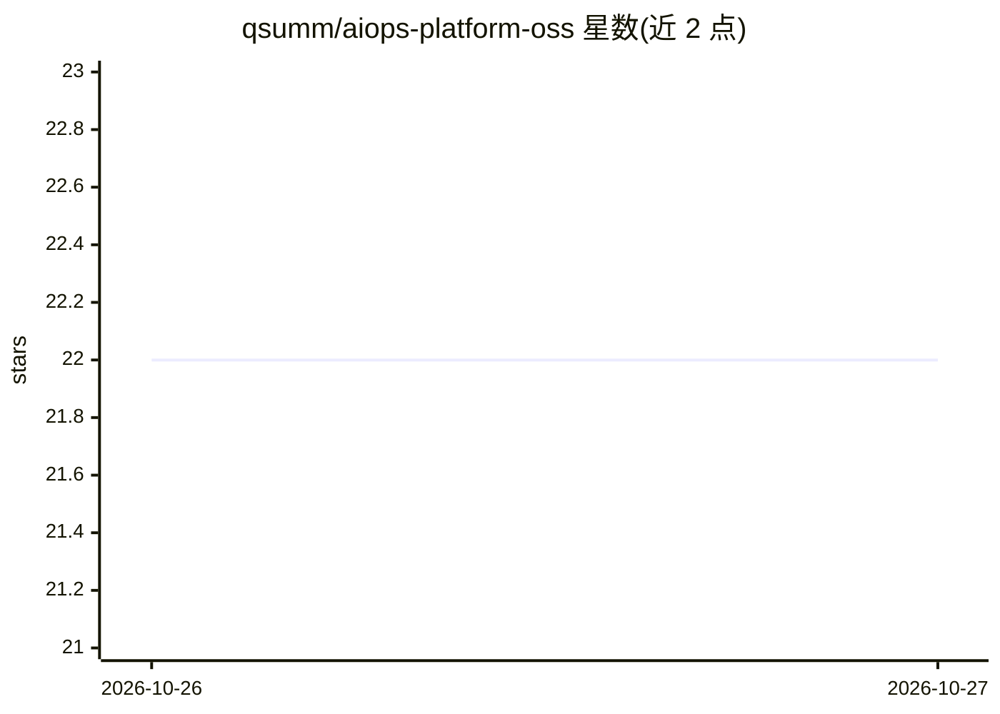

# qsumm/aiops-platform-oss

⭐ 22 · Python · AGPL-3.0 · 推送 2026-10-26 · [GitHub](https://github.com/qsumm/aiops-platform-oss) · 个人维护 · 中文 README

**面向中小团队的 AI 运维监控平台：告警、AI 诊断与护栏化处置**

自托管运维监控平台，功能覆盖主机/服务监控（Agent 拉取式、0 入站端口）、探活（TCP/HTTP/进程/证书）、阈值/3σ/孤立森林告警、多渠道通知含电话语音播报、ReAct 式 AI 根因诊断（最多 30 步留痕、技能自动路由、向量案例召回）、九条护栏与 4 个白名单动作的处置（建议/人工确认/自动三档）。不替代 Prometheus，不执行白名单外命令，默认人工确认。Docker compose 一条命令部署，内置向量检索，AGPL-3.0 并声明提供商业授权洽谈渠道。

## 筛选速览

| 维度 | 判定 | 备注 |
|---|---|---|
| AI 角色 | `ai-enhanced` | 去掉 AI 部分产品仍成立 |
| 许可风险 | `dual` | AGPL-3.0 |
| 部署形态 | `self-host` | docker 或自建部署 |
| 模型依赖 | — | README 未给出锁定关系 |
| 硬件要求 | — | 无带数字的原话,不猜 |
| 安装摩擦 | `low` | 无编译、无系统依赖或容器化 |
| 成熟度 | — | 结构信号不足 |

## 能力要点

- ReAct AI 诊断最多 30 步全留痕，结论必须引用证据
- 九条护栏准入与 4 个白名单处置动作，三档执行模式
- Agent 拉取式接入穿透 NAT，主机 0 入站端口
- 诊断技能以 SKILL.md 定义，GitHub 一键导入
- 诊断案例向量化沉淀，支持同类故障召回

## 适用场景

- 中小团队无人值守时段的告警盯守与根因排查
- 在防火墙/NAT 后的主机上部署监控与探活
- 告警触发后让 AI 取证诊断并走白名单处置流程
- 定时巡检生成健康日报并自动建事件

## 场景标签

 · 领域:运维监控/DevOps

## 证据(README 行号)

> L28: |诊断|ReAct 最多 30 步全留痕 · 技能自动路由 · 向量案例召回 · 置信度三档（查不出也是合法结论）|
> L45: **做**：主机与服务监控、主动告警（多渠道通知 + 电话语音播报）、AI 根因诊断（带证据链）、诊断技能自动路由（Agent 只读授权命令）、白名单内处置动作（重启/重连/轮转日志）、定时巡检、多维指标即时查询、案例沉淀。

## 星数曲线

2026-10-26 22 → 2026-10-27 22（+0）

---
*卡片 v1 · prompt 1.4 · 生成 2026-10-27 · 置信度 mid · 依据 README sha `2843fd4f33e1` · [字段定义](../../DATASET.md)*
