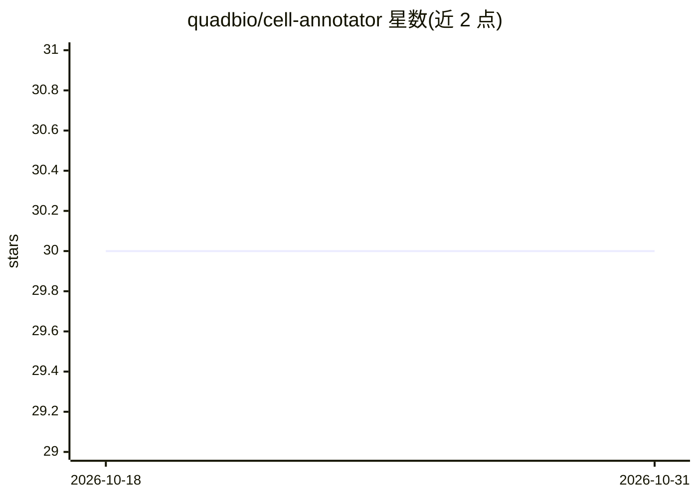

# quadbio/cell-annotator

⭐ 30 · Python · MIT · 推送 2026-10-26 · [GitHub](https://github.com/quadbio/cell-annotator) · [官网](https://cell-annotator.readthedocs.io) · 个人维护

**用 LLM 基于标记基因自动注释单细胞数据细胞类型**

scverse 生态的 Python 包：读取 scRNA-seq 数据（AnnData），基于聚类标记基因调用大语言模型，为各聚类生成细胞类型、状态与置信度注释，并可跨样本协调注释结果。支持 OpenAI、Google Gemini、Anthropic Claude 与 OpenRouter 四类提供方，仅需设置 provider 与 API key。仅发送标记基因与物种/组织信息，不发送基因表达值。README 提示基于 LLM 输出可能出错，建议作为注释工作流的第一步粗标注。

## 筛选速览

| 维度 | 判定 | 备注 |
|---|---|---|
| AI 角色 | `ai-native` | 本体是模型或模型工具 |
| 许可风险 | `permissive` | MIT |
| 部署形态 | `library` | 以包/库形式分发 |
| 模型依赖 | locked-api |  |
| 硬件要求 | — | 无带数字的原话,不猜 |
| 安装摩擦 | `low` | 无编译、无系统依赖或容器化 |
| 成熟度 | `idea` | |

## 能力要点

- 基于聚类标记基因生成细胞类型、状态与置信度注释
- 跨样本协调一致注释，支持单样本模式
- LLM 无关后端：OpenAI/Gemini/Claude/OpenRouter 开箱可用
- 仅发送标记基因列表，不发送基因表达数据

## 适用场景

- 为 scRNA-seq 聚类结果生成初步细胞类型标注
- 多样本研究中获得一致的细胞类型注释
- 生成整合前粗标签用于引导或评估整合（如 scIB、scANVI）

## 场景标签

 · 领域:生物信息学/单细胞组学

## 证据(README 行号)

> L11: 🧬 CellAnnotator is an scverse ecosystem package, designed to annotate cell types in scRNA-seq data based on marker 
> L16: - 🧬 **Automatically annotate cells** including type, state, and confidence fields.
> L63: By default, this will store annotations in `adata.obs['cell_type_predicted']`. Head over to our 📚 tutorials to see 

## 星数曲线

2026-10-18 30 → 2026-10-31 30（+0）

---
*卡片 v1 · prompt 1.4 · 生成 2026-10-26 · 置信度 high · 依据 README sha `fe87ef18bd79` · [字段定义](../../DATASET.md)*
