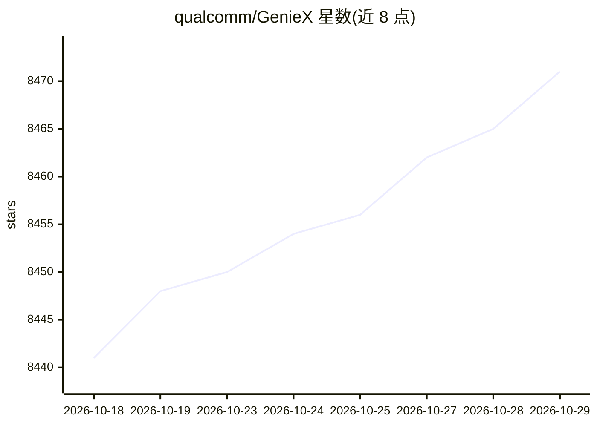

# qualcomm/GenieX

⭐ 8,471 · Go · BSD-3-Clause · 推送 2026-10-28 · [GitHub](https://github.com/qualcomm/GenieX) · [官网](https://geniex.aihub.qualcomm.com/en/get-started/what-is-geniex) · 组织维护

**面向开发者的高通设备端 LLM/VLM 推理运行时**

Qualcomm 官方维护的端侧 Gen AI 推理运行时，仅在 Snapdragon 平台运行。底层为单一 C SDK，暴露 CLI、Python、Kotlin/Java、Docker 与 OpenAI 兼容服务器接口；调度 llama.cpp 运行时（GGUF 跑 CPU/GPU/Hexagon NPU）或 Qualcomm AI Engine Direct（NPU 专用预编译 bundle），覆盖 Windows ARM64、Android 与 Linux ARM64。模型可从 Hugging Face、ModelScope、Docker Hub 拉取 GGUF，或从 Qualcomm AI Hub 获取预编译包。当前状态为 Developer Preview，许可 BSD-3-Clause 且附带 Qualcomm 使用条款。

## 筛选速览

| 维度 | 判定 | 备注 |
|---|---|---|
| AI 角色 | `ai-ecosystem` | LLM/agent 周边工具 |
| 许可风险 | `permissive` | BSD-3-Clause |
| 部署形态 | `self-host` | docker 或自建部署 |
| 模型依赖 | local-ok | 支持本地模型 |
| 硬件要求 | — | 无带数字的原话,不猜 |
| 安装摩擦 | `low` | 无编译、无系统依赖或容器化 |
| 成熟度 | `idea` | |

## 能力要点

- 单一 C SDK 暴露 CLI/Python/Kotlin-Java/Docker/OpenAI 兼容服务器五种接口
- 双运行时：llama.cpp（GGUF，NPU/GPU/CPU）与 QAIRT（NPU 预编译 bundle）
- 支持 LLM 与 VLM，模型来源覆盖 Hugging Face/ModelScope/Docker Hub/AI Hub
- 跨 Windows ARM64、Android、Linux ARM64 三平台

## 适用场景

- 在 Snapdragon 笔记本/手机/IoT 设备上本地运行 GGUF 模型推理
- 通过 OpenAI 兼容 API 在本机提供模型服务
- Android 应用内集成 Kotlin/Java 推理 SDK
- 用 NPU 预编译 bundle 获得峰值性能

## 场景标签

`推理引擎` `多模态` · 领域:感知与多模态

## 证据(README 行号)

> L13: GenieX is an **on-device Gen AI inference runtime for Qualcomm devices**. Bring almost any GGUF model from Hugging 
> L15:  GenieX architecture: CLI, Python, Java, Docker, and OpenAI-compatible Serve interfaces sit on a single GenieX SDK,

## 星数曲线

2026-10-18 8,441 → 2026-10-29 8,471（+30）

---
*卡片 v1 · prompt 1.4 · 生成 2026-10-20 · 置信度 high · 依据 README sha `0baf0938799c` · [字段定义](../../DATASET.md)*
