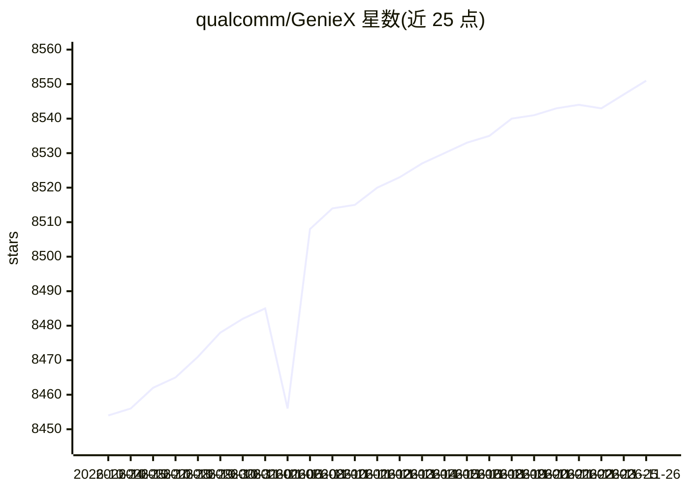

# qualcomm/GenieX

⭐ 8,551 · Go · BSD-3-Clause · 推送 2026-11-25 · [GitHub](https://github.com/qualcomm/GenieX) · [官网](https://geniex.aihub.qualcomm.com/en/get-started/what-is-geniex) · 组织维护

**高通设备上本地运行 LLM/VLM 的推理运行时**

面向 Qualcomm Snapdragon 设备的端侧生成式 AI 推理运行时，是 Qualcomm GENIE 的社区版。用户可从 Hugging Face、ModelScope 或 Docker Hub 拉取 GGUF 模型，或使用 Qualcomm AI Hub 预编译包，通过 CLI、Python、Kotlin/Java、Docker 及 OpenAI 兼容服务器调用底层统一 C SDK，在 Hexagon NPU、Adreno GPU 或 CPU 上运行。仅支持 Snapdragon 平台（Windows ARM64/Android/Linux ARM64），处于 Developer Preview 状态。

## 筛选速览

| 维度 | 判定 | 备注 |
|---|---|---|
| AI 角色 | `ai-ecosystem` | LLM/agent 周边工具 |
| 许可风险 | `permissive` | BSD-3-Clause |
| 部署形态 | `self-host` | docker 或自建部署 |
| 模型依赖 | local-ok | 支持本地模型 |
| 硬件要求 | — | 无带数字的原话,不猜 |
| 安装摩擦 | `low` | 无编译、无系统依赖或容器化 |
| 成熟度 | `idea` | |

## 能力要点

- 单一 C SDK 之上提供 CLI、Python、Kotlin/Java、Docker、OpenAI 兼容 server 五种接口
- 双运行时：llama.cpp（GGUF，NPU/GPU/CPU）与 Qualcomm AI Engine Direct（NPU）
- 兼容 OpenAI API 的本地服务端，OpenAI 客户端无需改代码即可接入
- 支持 LLM 与 VLM，模型来源覆盖 Hugging Face、ModelScope、Docker Hub

## 适用场景

- 在 Snapdragon 笔记本或手机上本地运行开源 LLM/VLM
- 通过 OpenAI 兼容接口让现有客户端连接本地模型
- 在 Android 应用中集成端侧模型推理

## 场景标签

`推理引擎` · 领域:训练与推理

## 证据(README 行号)

> L13: GenieX is an **on-device Gen AI inference runtime for Qualcomm devices**. Bring almost any GGUF model from Hugging 
> L15:  GenieX architecture: CLI, Python, Java, Docker, and OpenAI-compatible Serve interfaces sit on a single GenieX SDK,

## 星数曲线

2026-10-24 8,454 → 2026-11-26 8,551（+97）

---
*卡片 v1 · prompt 1.4 · 生成 2026-11-22 · 置信度 high · 依据 README sha `9f77622280fa` · [字段定义](../../DATASET.md)*
