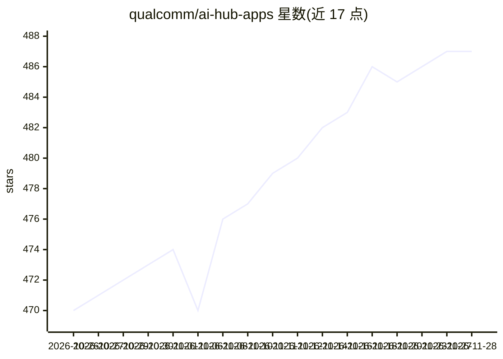

# qualcomm/ai-hub-apps

⭐ 487 · Python · BSD-3-Clause · 推送 2026-11-25 · [GitHub](https://github.com/qualcomm/ai-hub-apps) · 组织维护

**高通设备上的 ML 示例应用与教程合集**

面向高通平台开发者提供模型部署的示例应用与端到端教程：覆盖 Android/Windows/Ubuntu/IMSDK 四个目录，任务包括图像分类、目标检测、分割、语音识别、图像生成等，支持 TensorFlow Lite/ONNX/GenieX 三种推理运行时，CPU/GPU/NPU（Hexagon HTP）计算单元，NPU 加速需特定 Snapdragon 芯片且权重需 FP16/INT8/INT16 格式。各应用的构建与安装说明位于其子目录 README 中。

## 筛选速览

| 维度 | 判定 | 备注 |
|---|---|---|
| AI 角色 | `ai-ecosystem` | LLM/agent 周边工具 |
| 许可风险 | `permissive` | BSD-3-Clause |
| 部署形态 | `None` |  |
| 模型依赖 | — | README 未给出锁定关系 |
| 硬件要求 | — | 无带数字的原话,不猜 |
| 安装摩擦 | `low` | 无编译、无系统依赖或容器化 |
| 成熟度 | — | 结构信号不足 |

## 能力要点

- 支持 TensorFlow Lite、ONNX、GenieX SDK 三种推理运行时
- 支持 CPU/GPU/NPU（含 Hexagon HTP）计算单元
- 部署目标覆盖 Android 11+、Windows 11、Ubuntu 24.04+
- 含 LLM 端侧部署教程（Genie SDK/GenieX）

## 适用场景

- 在 Snapdragon 设备上部署图像分类、检测、分割等模型
- 在端侧运行 Whisper 语音识别与 Stable Diffusion 图像生成
- 按教程将 LLM 导出并部署到高通设备

## 场景标签

`图像生成` `教程课程` `语音识别` `目标检测` · 领域:内容生成

## 证据(README 行号)

> L3: The Qualcomm® AI Hub Apps are a collection of sample apps and tutorials to help deploy machine learning models on Qu
> L8: * Explore apps optimized for on-device deployment of various machine learning tasks.
> L10: * Find tutorials for end-to-end workflows.

## 星数曲线

2026-10-26 470 → 2026-11-28 487（+17）

---
*卡片 v1 · prompt 1.4 · 生成 2026-11-26 · 置信度 high · 依据 README sha `e9b0744daa22` · [字段定义](../../DATASET.md)*
