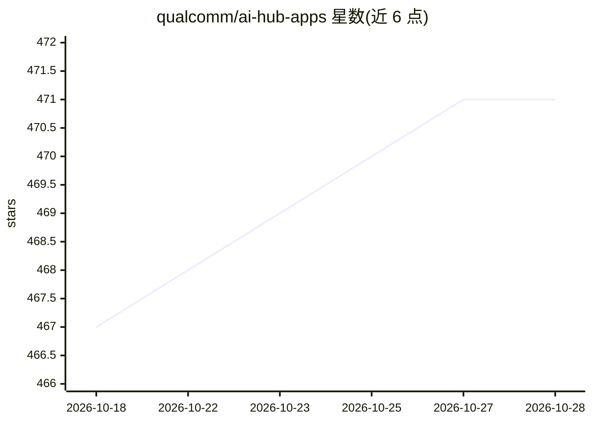

# qualcomm/ai-hub-apps

⭐ 472 · Python · BSD-3-Clause · 推送 2026-10-28 · [GitHub](https://github.com/qualcomm/ai-hub-apps) · 组织维护

**高通设备端部署机器学习模型的示例应用与教程集合**

Qualcomm 官方维护的仓库，收录面向高通芯片设备端部署机器学习模型的示例应用与端到端教程，覆盖 Android 11+、Windows 11、Ubuntu 24.04+ 三个平台。每个应用搭配 Qualcomm AI Hub Models 中的模型运行，支持的推理运行时包括 TensorFlow Lite、ONNX 与 Genie SDK，计算单元覆盖 CPU/GPU/NPU（含 Hexagon HTP）。示例任务含图像分类、目标检测、语音转文字、Stable Diffusion 图像生成等；NPU 加速需 Snapdragon 芯片，部分应用可在非 Snapdragon 芯片上无 NPU 运行。各应用的构建安装说明见其各自 README。

## 筛选速览

| 维度 | 判定 | 备注 |
|---|---|---|
| AI 角色 | `ai-ecosystem` | LLM/agent 周边工具 |
| 许可风险 | `permissive` | BSD-3-Clause |
| 部署形态 | `None` |  |
| 模型依赖 | — | README 未给出锁定关系 |
| 硬件要求 | — | 无带数字的原话,不猜 |
| 安装摩擦 | `low` | 无编译、无系统依赖或容器化 |
| 成熟度 | — | 结构信号不足 |

## 能力要点

- 覆盖 Android/Windows/Ubuntu 三平台的示例应用目录
- 支持 TensorFlow Lite、ONNX、Genie SDK 三种运行时
- NPU 加速支持 Snapdragon 系列芯片（Hexagon HTP）
- 包含 LLM 设备端部署教程（Genie SDK/GenieX）

## 适用场景

- 查找在骁龙设备上运行模型推理的参考实现
- 学习端到端的设备端模型部署工作流
- 为图像分类、目标检测、语音转文字等任务选择示例应用起步

## 场景标签

`教程课程` · 领域:学习与行业

## 证据(README 行号)

> L3: The Qualcomm® AI Hub Apps are a collection of sample apps and tutorials to help deploy machine learning models on Qu
> L9: * View open-source app recipes for running Qualcomm® AI Hub Models on local devices.
> L10: * Find tutorials for end-to-end workflows.

## 星数曲线

2026-10-18 467 → 2026-10-28 471（+4）

---
*卡片 v1 · prompt 1.4 · 生成 2026-10-21 · 置信度 high · 依据 README sha `07c5aeca047a` · [字段定义](../../DATASET.md)*
